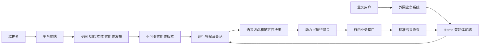

# 功能接入与智能体路由契约

版本：V2.1｜日期：2026年9月21日｜状态：研发评审稿，尚未实现

本文件配套[银行内网本体意图中台一期方案 V2.1](./银行内网本体意图中台一期方案_V2.1.md)，把“空间内自助接入 20 功能 → 语义与动力映射 → 打包一个智能体 → 内网准确路由 → iframe 统一交互”落实为资源、接口和状态约定。所有示例 ID、地址、业务字段均为设计示例，不代表已取得真实银行 API 或已完成联调。

## 1 两套前端与共用后端

| 交付物 | 建议入口 | 可用接口 | 核心边界 |
|---|---|---|---|
| `platform-console` 平台前端 | `/console` | `/api/v2/management/...` | 空间管理、功能和文档接入、本体映射、选功能、评测、发布、回滚 |
| `agent-web` 智能体独立页 | `/agents/{agent_id}` | `/api/v2/runtime/...` | 已发布智能体的会话、补参、消歧、结果与反馈 |
| `agent-web` 智能体嵌入页 | `/embed/agents/{agent_id}` | `/api/v2/runtime/...`、票据兑换 | 与独立页共用运行组件，适配 iframe 登录、尺寸与宿主生命周期 |

两套前端拥有独立构建产物，可以共享类型和基础组件。建议分别由内网管理域名和内网智能体域名提供；路径可按行内网关规范调整。后端可以是同一个 Python 模块化应用，但管理接口和运行接口分别鉴权，不能仅靠前端隐藏菜单实现隔离。

每个智能体的名称、欢迎语、功能版本、展示配置、可访问用户和嵌入来源由发布包决定。多个智能体复用一套 Agent Web 程序，**不是每组合 20 个功能就生成一份新前端代码**。一个 iframe 默认绑定一个智能体，用户在一个输入框和会话中使用该智能体的全部已授权功能。



## 2 资源模型与版本边界

| 资源 | 所属与内容 | 版本规则 |
|---|---|---|
| Workspace | 个人或团队空间、成员角色、资源授权 | 成员与授权实时生效 |
| DomainPackage / Concept | 公共、领域或空间私有概念，属性、关系、角色、结果类型 | 稳定概念 ID；已发布定义不可原地修改 |
| FunctionDraft | 接口、文档、映射草稿、测试样例、待解决冲突 | 可编辑，不进入正式运行 |
| FunctionVersion | 一项业务功能的语义、动力、参数、文档和展示契约 | 发布后不可变；紧急禁用单独生效 |
| Agent / AgentRelease | 场景智能体及其功能集合、本体投影、模型和 UI 配置 | 发布生成不可变快照；新旧版本可追溯 |
| RuntimeSession / Conversation | 用户、空间、智能体版本、可信身份、会话状态 | 绑定真实用户；跨用户不可继承 |
| Run / Call / Event | 请求、具体调用、执行结果与前端事件 | 稳定 ID、单调事件序号、幂等与审计记录 |

用户看到的“功能”在运行协议中由稳定的 `capability_id` 标识；一期默认一项功能对应一份可调用能力契约。多接口流程可以由已注册的复合连接器封装，对用户仍是一项明确业务功能。不能把一个用途的 20 个接口版本计成 20 个不同功能。

所有资源查询由服务端从已验证身份解析空间权限。路径中的空间 ID 是待授权资源，不是身份声明。数据访问、文档处理任务、投影缓存、会话事件和文件都携带空间归属，数据库约束与应用授权共同防止串用。

## 3 自助接入与权威来源

接入向导固定为：接口与文档导入 → 本地解析 → 生成映射草稿 → 用户确认或补齐 → 连通与契约测试 → 语义正反例测试 → 发布。模型辅助起草，不能替代维护者确认业务边界。

| 信息 | 主要来源 | 冲突时的处理 |
|---|---|---|
| 方法、路径、字段类型、鉴权、响应结构 | API 定义与真实接口样例 | 阻止发布，由接口负责人确认；不让说明文档覆盖接口实情 |
| 业务目的、术语、适用范围、相近功能差异 | 功能说明、领域定义、用户补充 | 展示文档来源和映射建议，用户确认 |
| 对象 ID、当前用户、机构、数据权限 | 行内身份服务、业务系统、授权实体解析器 | 不接受模型虚构或前端任意指定 |
| 成功条件、异步状态、重试与幂等 | 下游正式契约与联调证据 | 未知保持未知，不由平台假设成功 |
| 卡片类型、字段展示和脱敏 | 输出结构、平台组件和空间策略 | 发布前通过字段映射及展示预览 |

文档提取的每条业务定义保存 `document_id + revision + section`；模型建议另标 `suggested`，用户确认后才成为正式映射。上传文档中的指令不能改变平台权限、模型系统规则或请求目标地址。

自助调用地址受空间获准连接器和内网目标白名单控制，不能因为“全部在内网”就允许访问任意管理端口、主机元数据或其他空间服务。凭证仅存行内密钥系统，表单和数据库契约保存引用。网关验证协议、解析地址、重定向和实际目标；文档或模型输出不能临时改写目标地址。

已有连接器支持的 API 和鉴权可通过表单接入；特殊签名或专有协议需增加受控连接器。该边界须在导入时显示，不拖到发布失败时才发现。

### 3.1 功能版本示例

下例展示“客户基本资料查询”的最小完整结构。`bank:*` 概念和 `resolver.customer` 均须来自有版本的已发布注册项；`customer_id` 必须由可信上下文或获准实体解析器取得，模型不能把显示名称冒充业务主键。

```json
{
  "workspace_id": "ws_demo",
  "capability_id": "customer.profile.read",
  "version": "1.0.0",
  "name": "客户基本资料查询",
  "documents": [
    {"document_id": "doc_profile", "revision": 2, "section": "功能范围"}
  ],
  "semantic": {
    "action": "READ_ATTRIBUTES",
    "object_type": "bank:Customer",
    "participant_roles": [{"role": "target", "type": "bank:Customer", "required": true}],
    "result_type": "bank:CustomerProfile",
    "definition": "查询已获授权客户的基本资料和所属机构",
    "exclusions": ["客户交易流水", "修改客户资料", "授信审批"],
    "positive_examples": ["查看华星公司的基本信息"],
    "negative_examples": ["查询华星公司本月交易记录"]
  },
  "kinetic": {
    "connector_ref": "http_json@1",
    "endpoint_ref": "crm.customer_profile@1",
    "credential_ref": "secret_ref_crm_read",
    "input_schema": {
      "type": "object",
      "properties": {"customer_id": {"type": "string", "minLength": 1}},
      "required": ["customer_id"],
      "additionalProperties": false
    },
    "argument_bindings": {
      "customer_id": {"role": "target", "resolver_ref": "resolver.customer@1"}
    },
    "preconditions": ["identity.authenticated", "customer.read.authorized"],
    "effect": "READ_ONLY",
    "output_schema_ref": "bank:CustomerProfile@1",
    "success_rule_ref": "crm.profile_response_success@1",
    "timeout_ms": 5000,
    "retry_policy": {"max_attempts": 2, "conditions": ["transient_transport_failure"]}
  },
  "presentation": {
    "component": "detail",
    "schema_version": "1",
    "field_map": {"客户名称": "customer_name", "所属机构": "branch_name"}
  }
}
```

`endpoint_ref` 指向经过验证的方法、路径和参数映射；`success_rule_ref` 必须指向已注册的安全声明式规则，禁止任意 Python/JavaScript 表达式。用户通过规则表单选择响应字段、比较值及逻辑组合；高级特例由连接器实现。

### 3.2 本体编译和约束一致性

权威输入是版本化 JSON 元模型。短语义卡、结构化输出 Schema、运行校验器和 RDF/SHACL 都由它生成；不得在 RDF 和 JSON 中分别维护两套正式业务定义。RDF/SHACL 用于发布期结构校验，运行路径使用 Python 确定性约束；两者都不能证明业务事实或授权成立。

| 一期约束子集 | 固定含义与校验要求 |
|---|---|
| 稳定类型与有限继承 | 单一主类型及显式父类型闭包；循环、未知类型阻止发布 |
| 角色与关系方向 | 参与者类型、角色名、关系的起点和终点必须显式；不自动交换方向 |
| 必填、缺失、空值 | 缺字段与 `null` 区分；空值仅在明确允许时接受，不等于“未限制” |
| 基数 | 标明单值／多值、最小与最大数量，按值校验，禁止隐式取第一项 |
| 枚举和数值边界 | 严格类型；单位须显式，只有登记了转换规则才能换算 |
| 时间 | 日期和时间戳区分；相对时间依据可信请求时间及空间时区解析，并保留解析依据 |
| 前置条件 | TRUE / FALSE / UNKNOWN 三值；UNKNOWN 不能当 TRUE 触发执行 |

共享同一组正反例，验证发布约束和热路径约束对上述子集的判断一致；暂不支持的 OWL 推理、任意规则和多重类型语义必须明确报“不支持”，不能静默降级。Schema 格式正确之后仍须检查动作、角色、对象、结果类型与功能边界是否匹配。

## 4 智能体发布包

发布包至少固定以下内容：

| 字段 | 作用 |
|---|---|
| `agent_id / release_id / workspace_id` | 唯一确定场景智能体、版本和空间 |
| `capabilities[]` | 每项功能的稳定 ID 和不可变版本；验收智能体必须有至少 20 项 |
| `ontology_projection_ref` | 仅包含所选功能需要的概念、关系、角色和约束 |
| `document_revisions / connector_versions` | 对应说明来源和调用实现 |
| `model_profile_ref / prompt_policy_version` | 内网模型、输出 Schema、上下文限制与提示版本 |
| `conversation_policy` | 历史长度、补参、消歧、确认、超时与版本固定规则 |
| `runtime_ui` | 名称、欢迎语、建议问题、主题基础参数、获准组件与版本 |
| `embedding_policy` | 获准宿主、允许 Origin、票据和运行会话策略 |
| `evaluation_ref` | 功能接入与发布评测记录 |

发布是原子操作：校验全部依赖后一次性生成 release，更新当前发布指针。失败时继续提供原版本，不能出现“新本体 + 旧功能 + 未完成 UI 配置”的半成品。旧会话固定其创建时的 release；新会话使用当前 release。模型服务应保留对应版本，缺失时明确服务不可用，不能偷偷替换成另一个模型。

权限撤销、功能禁用、宿主禁用和会话撤销独立于版本快照实时检查。回滚只改变新会话默认版本，不恢复已撤销的权限。普通描述或样式修改不使旧会话继承新业务语义。

**至少建立三个验证配置**：一个启用全部 20 项的智能体；两个使用不同功能子集的场景智能体。具体子集按真实清单决定，不能用示例业务名代替真实接入。

## 5 路由建议、服务端决定与执行

### 5.1 模型输入和候选边界

候选集合为 `release.capabilities ∩ workspace有效可见能力 ∩ 当前用户可调用能力`。先鉴权再形成模型输入；对象级数据权限在实体绑定后、调用前再次检查。短卡和本体投影缓存必须包含空间、release、授权范围或权限版本，不能把前一用户的投影复用给另一权限范围的用户。

一期对 20 项采用全量可见短卡，不依赖召回阶段先猜对功能。正文与大型响应 Schema 按需加载。提取业务语义的模型只接收有限候选、必要本体、受控历史和本轮消息；它没有直接调用网关的权限。

### 5.2 模型建议示例

```json
{
  "context_relation": "NEW_TOPIC",
  "requests": [
    {
      "request_key": "r1",
      "action": "READ_ATTRIBUTES",
      "object_type": "bank:Customer",
      "participant_roles": [{"role": "target", "mention": "华星公司"}],
      "constraints": [],
      "result_type": "bank:CustomerProfile",
      "capability_candidate": "customer.profile.read",
      "arguments": {},
      "missing_arguments": ["customer_id"]
    }
  ]
}
```

模型记录提及词；服务端实体解析后若唯一且有权访问，可直接完成绑定，不必因模型输出了 `missing_arguments` 就机械追问。存在同名对象时向用户展示其有权选择的脱敏选项；无权实体不能进入选择列表。

对功能输出、文档和历史中的命令均按数据处理。模型候选必须属于本轮候选集，不能使用输出中的 `workspace_id`、URL、密钥名或角色声明扩大权限。

### 5.3 服务端决定

| `decision` | 含义 | Agent Web 表现与后续动作 |
|---|---|---|
| `READY` | 功能、参数、前置条件和当前授权全部通过 | 展示运行进度，由服务器登记调用后执行 |
| `NEEDS_ARGUMENTS` | 业务功能已确定，但缺必要输入 | 展示补参表单；不重新要求用户选功能 |
| `AMBIGUOUS` | 功能含义或实体确实存在多个可行解释 | 展示明确问题与允许选项 |
| `NEEDS_CONFIRMATION` | 有效果的操作需用户确认且已可执行 | 展示对象、动作、关键参数、影响及有效期 |
| `OUT_OF_SCOPE` | 智能体没有支持该诉求的有效功能 | 说明能力范围；不调用其他智能体私有功能 |
| `FORBIDDEN` | 服务器发现授权不足或已撤销 | 返回不泄露私有功能／对象的通用提示 |
| `ERROR` | 模型、规则、服务或协议无法产生可靠决定 | 给出可追踪错误和允许重试方式，不伪造业务结果 |

外部输出可把敏感场景的 `FORBIDDEN` 统一呈现为“当前无法处理此请求”，内部审计保留真实原因。没有可见候选时不能借助管理员视图判断用户试图调用什么私有功能。

语义变化或当前对象变化后，原补参、选项和确认全部失效。确认绑定 `run_id + revision + capability_version + 规范化参数快照 + 身份 + 有效期`，不能把用户确认 A 解释成授权 B。业务接口仍应实施自身权限和交易校验。

一句有两个明确、独立的只读诉求时，保留两个 request 并分别路由和展示。跨功能依赖只通过登记过的复合 API／工作流执行；未支持的组合明确说明限制，不自行拼接任意计划，也不漏掉其中一项。

### 5.4 有限会话状态与恢复

一期使用显式 Python 状态机管理 `RECEIVED → ROUTING → WAITING_INPUT / WAITING_CONFIRMATION / EXECUTING → SUCCEEDED / FAILED / UNKNOWN / CANCELLED`。`OUT_OF_SCOPE` 等决定以不调用业务的终结事件结束本轮。LangGraph 可在后续替代状态机驱动实现，不与另一套驱动同时对同一会话推进。

- 每条用户消息使用 `client_message_id` 去重；每个已接受业务请求由服务器分配稳定 `run_id`，修订增加 `revision`。
- 每个逻辑调用使用服务端分配的 `action_id`，数据库对 `(run_id, action_id)` 唯一约束；未变动作跨 revision 复用原 action_id 和 call_id，revision 记录来源并控制执行资格，不能因修订另一子诉求重复执行。只有用户新增或实质改变且重新获得授权的动作才能分配新 action_id；已成功或结果未知的旧动作先复用结果或对账，模型重放不能自行分配新调用绕过去重。
- 待提交调用、业务状态变更及前端 outbox 事件在一个数据库事务中登记。工作器先领取调用再访问下游；进程恢复时先对账，不重新解释一遍旧消息就直接执行。
- 网络中断后不知道业务是否完成时，调用进入 `UNKNOWN`，按下游幂等键或 operation_id 查询。没有查询和幂等保证的写操作停止自动重放，需要人工核实；平台不能承诺外部副作用 exactly-once。
- 用户取消等待中的输入可以立即生效；已发出的业务调用只能请求下游取消，不把“用户离开”当成业务已撤销。旧调用结果归属原 run/revision，不能覆盖用户改口后的当前对象或自动触发旧目标。
- 同一会话新消息与待执行调用竞争时，在发出前重新核对 revision 和状态。已经发送的调用保留审计与最终状态，界面明确其属于此前请求。

恢复验证至少覆盖调用发送前进程退出、下游成功但本地未记录、事件已入库但前端未接收三个窗口。

## 6 管理接口与运行接口

以下为建议 API 清单；实际字段须在开发时固化 OpenAPI 和契约测试。列出的路径表达职责，不代表已有服务。

| 面向 | 方法与路径 | 作用及校验 |
|---|---|---|
| 平台 | `POST /api/v2/management/workspaces/{ws}/functions/import` | 导入 API 与文档，校验维护权限，创建解析任务 |
| 平台 | `PATCH .../functions/{id}/draft` | 修改接口、映射、来源与样例；携带草稿 revision 防覆盖 |
| 平台 | `POST .../functions/{id}/validate` | 语义、参数、权限、连接、成功失败响应与展示测试 |
| 平台 | `POST .../functions/{id}/publish` | 校验通过后生成不可变功能版本 |
| 平台 | `POST .../agents`、`PATCH .../agents/{id}/draft` | 选功能及版本，配置智能体与嵌入来源 |
| 平台 | `POST .../agents/{id}/publish` | 校验依赖与评测，原子发布；生成独立页和嵌入地址 |
| 宿主后端 | `POST /api/v2/integrations/embed-tickets` | 可信终端身份换取绑定智能体及握手的一次性票据 |
| Agent Web | `POST /api/v2/runtime/embed/exchange` | 兑换票据，创建或续接运行会话，不授予管理 scope |
| Agent Web | `POST /api/v2/runtime/agents/{id}/conversations` | 当前用户创建会话，固定 release |
| Agent Web | `POST .../conversations/{id}/messages` | 幂等接收消息，返回 run_id；身份由会话确定 |
| Agent Web | `POST .../runs/{id}/answers` | 提交 question_id、revision、option_id／字段值；拒绝过期答案 |
| Agent Web | `POST .../runs/{id}/confirmations` | 绑定具体参数快照的确认／拒绝 |
| Agent Web | `GET .../conversations/{id}/events?after={sequence}` | 带身份读取事件，游标恢复不触发新业务调用 |
| Agent Web | `GET .../files/{id}` | 对所属空间、用户、会话和数据权限重新鉴权 |
| Agent Web | `POST .../sessions/logout` | 撤销当前运行会话和未完成输入，结束事件流 |

`...` 在管理行指所属空间路径，在运行行指 `/api/v2/runtime`；上线 OpenAPI 必须展开完整路径。运行令牌访问任何管理 API 一律拒绝。外部输入不能指定任意函数名、模型服务地址或连接器凭证。

## 7 iframe 集成协议

### 7.1 发布后的嵌入产物

平台为每个已发布智能体提供：独立运行地址、iframe 地址、允许宿主清单、宿主后端接入说明、消息协议版本、组件版本与联调页。联调页使用普通终端身份，不能继承平台管理员令牌来掩盖授权缺陷。

嵌入示例仅表达页面入口，实际域名按行内环境配置。URL 中只有非敏感智能体标识和获准宿主配置标识，不携带业务用户信息、API 密钥或访问令牌。

```html
<iframe
  id="bank-agent"
  src="https://agent.bank.internal/embed/agents/agent_demo?integration=crm_portal"
  title="业务智能体"
  style="width:100%;height:680px;border:0"
  referrerpolicy="no-referrer">
</iframe>
```

浏览器允许嵌入由 Agent Web 响应头的 CSP `frame-ancestors` 控制；宿主还需允许加载智能体域名。网关不能同时注入阻止合法跨域嵌入的冲突策略。嵌套多层 iframe 时需核对全部祖先来源。平台管理页默认禁止被外围系统嵌入。配置 `sandbox` 时逐项验证脚本、Origin、表单和下载能力，不直接套用会破坏鉴权的模板。[浏览器 frame-ancestors 规则](https://developer.mozilla.org/en-US/docs/Web/HTTP/Reference/Headers/Content-Security-Policy/frame-ancestors)

### 7.2 登录与握手

1. Agent Web 根据已发布的 `integration` 配置得到允许的宿主 Origin，生成随机实例 nonce，并与服务端登记短期握手记录。该 nonce 只用于本次 iframe 实例，不能充当登录凭证。
2. iframe 向配置中的精确宿主 Origin 发送 `AGENT_READY`，包含协议版本、agent_id、instance_nonce。宿主校验 `event.origin` 为智能体域名、`event.source === iframe.contentWindow`，并核对智能体与当前 iframe 实例。
3. 宿主浏览器请求自己的后端。宿主后端验证当前已登录用户后，以获准服务身份及可信用户委托请求中台票据；中台验证宿主能为该用户、空间和智能体申请运行权限。仅有服务账号或浏览器提交的 user_id 不足以任意冒充用户。
4. 中台签发一次性短期票据，绑定用户、agent、integration、宿主 Origin、instance_nonce、到期时间与可续接会话。建议票据有效期 60 秒，实际值由行内策略固定。
5. 宿主用精确 `targetOrigin` 向 iframe 发送 `AGENT_INIT` 和票据。iframe 校验 `event.origin`、`event.source === window.parent`、消息 Schema、agent_id 和 instance_nonce 后，通过自身运行接口兑换。
6. 服务端原子消费票据，校验绑定、时效、握手及当前授权，创建或续接 runtime_session，返回限定 audience、agent、用户和运行 scopes 的短期令牌。过期、重放、跨智能体或跨握手兑换均拒绝。

Origin 是浏览器边界，不能代替身份认证；服务端不会因为请求体声称来自某 Origin 就信任终端用户。握手依靠获准宿主、CSP、浏览器消息来源校验和一次性票据共同建立，身份仍由可信后端委托确定。[postMessage 的来源及发送目标要求](https://developer.mozilla.org/en-US/docs/Web/API/Window/postMessage)

运行令牌默认保存在 iframe 内存，通过 `Authorization` 请求同源运行 API；不保存到 URL 或长期 localStorage。流式响应采用支持请求头的 fetch 流实现，不把长效令牌放入事件流 query。运行页身份流程不以第三方 Cookie 可用为前提，正式验收包括禁用第三方 Cookie 的浏览器配置。[第三方 Cookie 的浏览器限制](https://developer.mozilla.org/en-US/docs/Web/Privacy/Guides/Third-party_cookies)

### 7.3 续期、退出与宿主消息

| 消息 | 方向 | 行为 |
|---|---|---|
| `AGENT_READY` / `AGENT_INIT` | 双向握手 | 按上述步骤绑定当前实例；重复初始化不得启动重复业务 |
| `AUTH_REQUIRED` | 智能体 → 宿主 | 令牌将过期或失效时请求重新获取票据，等待期间停止新调用 |
| `AGENT_RESIZE` | 智能体 → 宿主 | 建议内容高度，宿主限定最小最大值并处理内部滚动 |
| `HOST_LOGOUT` | 宿主 → 智能体 | 清除浏览器状态、停止事件流，并请求服务端撤销运行会话 |
| `AGENT_ERROR` | 智能体 → 宿主 | 传递通用状态和 trace_id，不默认转发会话或客户数据 |

所有消息都包含协议版本、agent_id 和 instance_nonce；双方校验精确 Origin、发送窗口及消息结构，不使用 `*` 发送票据。消息类型采用白名单，不能把 postMessage 变成任意 API 调用通道。

续期仍由宿主后端验证用户并签发新票据，服务端只允许同一用户和智能体续接原 runtime_session。用户已切换时必须结束旧会话访问，创建新身份会话。独立运行页使用行内 SSO 完成同等身份与 runtime_session 建立，不依赖存在 window.parent。

退出不能只靠前端消息：宿主退出同时通过后端或行内 SSO 注销事件撤销关联 runtime_session；网关检查服务端撤销状态并关闭已有事件流。无法接入立即注销事件的系统必须在上线前明确最大失效窗口并配置短有效期，不能声称具备即时单点退出。

### 7.4 界面行为与结果协议

前端事件信封统一为 `schema_version、conversation_id、run_id、revision、sequence、event_type、payload`。按会话 sequence 去重；重连携带最后确认序号，只恢复事件，不重新发用户消息。历史被清理时返回需重新同步提示，而不是默默丢失部分结果。

| 组件 | 一期统一交互 | 来源要求 |
|---|---|---|
| text / markdown | 文本与受控格式回答 | 禁止任意 HTML、脚本和未过滤链接 |
| detail / table | 详情、列表、字段脱敏、受控分页 | 已校验的业务响应及字段映射 |
| form / choice | 补参表单、实体或功能消歧 | 服务端 question_id、revision 和当前有效选项 |
| confirmation | 操作影响和明确确认按钮 | 服务端参数快照与确认有效期 |
| progress / error | 调用中、异步受理、失败或结果未知 | 真实执行状态，不能用文本推断成功 |
| citation / file | 内网资料引用、结果文件 | 每次读取授权；链接不能泄露私有路径或凭证 |

例如，业务响应通过字段映射形成以下事件，20 项功能均遵守同一信封与组件协议：

```json
{
  "schema_version": "1",
  "conversation_id": "conv_demo",
  "run_id": "run_demo",
  "revision": 1,
  "sequence": 8,
  "event_type": "RESULT",
  "payload": {
    "call_id": "call_demo",
    "status": "SUCCEEDED",
    "component": "detail",
    "title": "客户基本资料",
    "fields": [{"label": "客户名称", "value": "华星公司"}],
    "provenance": {"capability_id": "customer.profile.read", "version": "1.0.0"}
  }
}
```

文件由带鉴权的 fetch 下载并交付浏览器，或经批准的短期单次下载协议；不返回公开永久链接。模型生成的 URL 不作为可信导航；跳转只接受连接器登记的内网目标和服务端校验参数。敏感会话内容默认不通过宿主消息回传，是否共享需另有明确业务授权。

新功能适配既有组件即可加入同一智能体界面。确需新组件时，经平台受控扩展和版本测试后加入组件注册表；普通用户不能上传任意前端代码到智能体页面执行。

## 8 最小持久化与安全约束

一期可按资源簇组织表：空间成员与授权、概念与功能版本、智能体发布、运行会话与会话消息、run/call、事件 outbox、文档与文件、评测与审计。无需为了三层划分拆成三个数据库或三个微服务。

必须落实的唯一性与访问约束包括：空间内资源 ID 的归属校验；功能 ID+版本和 agent+release 的唯一性；会话内 client_message_id 去重；调用槽位唯一性；事件 sequence 唯一性；票据原子消费；问题回答与确认的 revision 比对。数据库策略、工作器与缓存必须使用同样的权限上下文。

审计记录谁在何空间、哪个智能体版本、哪次请求中调用哪个功能、使用哪些参数来源、最终状态及错误归因。默认不把密钥、票据、完整敏感响应写入普通日志。原始评测证据与生产日志使用各自授权和保存周期，全部保存在内网。

## 9 可核对的验收清单

准确率、数据规模和性能数值沿用总体方案第 11 节；这里补充产品与契约检查。所列均为待执行验收，不能因文档示例可解析就认定通过。

| 编号 | 必须证明的行为 | 通过证据 |
|---|---|---|
| A01 | 有权限用户在隔离空间加入至少 20 个不同业务功能 | 20 项清单、真实接口联调、语义与动力映射、发布记录 |
| A02 | 同一智能体同时启用全部 20 项 | 发布快照及完整候选审计；不能拆成 20 个单功能智能体替代 |
| A03 | 功能子集组合和领域扩展 | 两个子集智能体及新增领域定义通过，不改业务路由核心 |
| A04 | 现场接入第 21 项既有连接器支持的功能 | 界面接入、映射、发布和影响回归；无代码或全局提示特例 |
| A05 | 语义层与动力层真实参与运行 | 相近功能、角色反转、否定、参数和前置条件正反例，以及本体消融对比 |
| A06 | 空间、用户、智能体边界 | 两空间同名功能、两用户不同权限；文档、缓存、调用、会话、事件、文件均无串用 |
| A07 | 平台与智能体前端分离 | 独立产物和入口；运行令牌无法访问管理 API；平台页面不能充当正式嵌入页 |
| A08 | 真实宿主 iframe 中的 20 功能体验 | 同一会话执行全量功能测试、补参、消歧、结果、滚动、尺寸、下载、重连 |
| A09 | iframe 身份与消息协议 | 禁用第三方 Cookie 仍可用；错误 Origin/source/nonce、票据重放和跨 agent 兑换均拒绝 |
| A10 | 登录过期、用户切换和退出 | 新身份无法读旧会话；权限撤销后事件流和新调用停止；撤销时效符合冻结策略 |
| A11 | 发布回滚与会话固定 | 新旧发布并存，草稿不影响正式会话，禁用权限不因回滚恢复 |
| A12 | 超时、故障与恢复 | 三个故障窗口均不自动重复未知写操作，断流恢复不重复执行业务 |
| A13 | 全部内网运行 | 阻断外网后冷启动、恢复、文档导入、发布、20 功能问答及前端展示均可用 |
| A14 | 准确与高效 | 封存 20 功能评测，按功能报告路由、参数、边界、多轮、真实调用展示和负载曲线 |

S1 路由集纳入已授权、参数充分的请求，每项功能各 50 条；金标同时区分 READY 与 NEEDS_CONFIRMATION。必要确认可算正确路由，但跳过确认或无依据增加确认均判错；确认前零业务执行及确认后成功另行验收。不得排除确认型功能来满足路由指标，端到端脚本提交绑定真实 run/revision 和参数快照的确认。

单个字段或功能的可逆修改做受影响契约和混淆功能测试；模型、公共本体、提示策略、状态机、身份协议或发布版本大改执行全量回归。文档阶段检查链接、示例及前后术语一致性；真实 API、模型、浏览器与硬件验证是后续实现阶段必须完成的工作。
