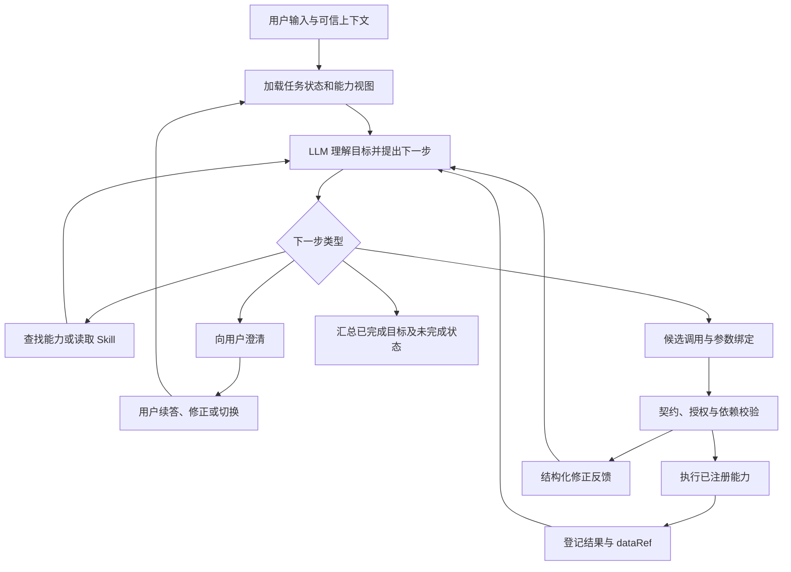

# 意图中台识别与能力路由建设方案

版本：v1.0｜日期：2026-09-10｜状态：架构评审稿

## 1. 方案结论与适用边界

本方案以《智驭版意图路由与功能映射说明》为主要参考，保留“语义表示、能力契约、真实结果引用、统一执行生命周期”，调整“过早冻结语义、候选封闭、固定动作映射、Question 只能续答”等限制。

推荐采用：**大模型统一理解用户目标与下一步动作 + API/Skill 驱动的能力注册 + 可扩展能力检索 + 可修订任务状态 + 受契约约束的执行。**

第一版不建设关键词路由引擎，不用意图树逐层单选，不预设所有请求都经过“小模型 → 重排 → 大模型”的级联。保留大模型直接判别作为基线；检索、缓存、组合能力和其他加速方式均通过业务评测决定是否启用。

中台输出的核心是“用户希望完成哪些目标、已经确定什么、下一步需要哪些能力、还缺什么”，不是必须唯一命中的意图编号。意图标签和树形目录用于运营组织、统计及辅助检索。

### 1.1 建设范围

- 能力接口及 Skill 文档接入、编译、版本管理。
- 单轮与多轮语义理解、能力发现、参数提议。
- 多目标、条件、顺序及数据依赖表示。
- 语义修订、澄清、任务切换和结果反馈续接。
- 与执行网关的协议、结果引用及回放评测。
- 必要的管理界面：能力目录、接入检查、调试、规则审视、版本发布与错误分析。

业务 API、业务算法、业务数据和最终业务权限由功能端提供。中台不自行实现客户查询、推荐模型、找人服务等业务功能。执行网关可以复用智驭版现有能力，不要求新建一套完整业务执行平台。

### 1.2 当前已知与待接入内容

已知输入是附件中描述的能力结构和路由实践。尚未收到完整实际 API 契约及接口 Skill 文档，因此本文中的新接口、字段、预算和案例均为建议设计，不代表现网已支持。正式能力映射、字段绑定、性能目标将在首批接口接入后确定。

附件中的“已核验”属于原文声明，本方案没有独立核验其对应提交和实现。

## 2. 从现有设计保留什么、改变什么

| 原设计 | 本方案处理 | 原因 |
|---|---|---|
| 动作、能力、工具分离 | 保留，动作可多选且可选填 | 防止动作枚举成为能力接入的唯一通道 |
| frames、参与者、关系、依赖 | 保留，简单请求采用紧凑结构 | 支持复合需求，同时避免简单请求生成大图 |
| 冻结语义快照 | 改成版本化语义假设 | 保存历史，但允许用新证据修正误解 |
| 候选闭合 | 注册及授权边界闭合，本轮检索结果可扩展 | 不执行虚构工具，也不因召回遗漏永久失去正确能力 |
| 每类动作匹配专用策划器 | 使用契约驱动编译；复杂业务保留已注册工作流 | 新增能力尽量不新增语义分支代码 |
| 服务端覆盖可信字段 | 按来源、确认状态和新鲜度管理 | 服务端存储的模型猜测不自动成为事实 |
| dataRef 与生命周期 | 保留并增加类型、基数、完整性、时间及访问范围 | 确保后续统计和分析使用正确证据 |
| Question 恢复原计划 | 支持续答、否定候选、改目标、取消与切换 | 用户回答不一定是原问题的一个选项 |
| 固定 DAG | 已执行历史不变，未执行计划可修订 | 接口返回结果可能改变下一步需求 |
| 答案型兜底门禁 | 保留真实状态，允许独立目标部分成功 | 不伪装成功，也不让一个失败吞掉整轮任务 |
| 多执行模式 | 第一版收敛为直接执行与有状态任务循环 | 减少模型提前选执行模式的负担 |

## 3. 核心对象：把目录、需求和执行分开

### 3.1 五类核心对象

| 对象 | 内容 | 管理方 |
|---|---|---|
| Capability 能力 | 能完成的业务结果、适用范围、输入输出、证据要求 | 功能端发布，中台登记 |
| ToolBinding 接口绑定 | API、参数映射、鉴权方式、超时、错误与重试语义 | 功能端维护，网关执行 |
| TaskFrame 任务目标 | 用户原始目标、对象、条件、交付物和完成状态 | 中台识别及修订 |
| TaskPlan 任务计划 | 下一步调用、结果依赖、条件分支和等待点 | 中台提议，执行层校验 |
| Evidence 证据 | 用户声明、已确认对象、工具结果、可信页面上下文 | 分来源登记，禁止混成同一可信等级 |

能力和工具允许多对多：一个能力可以绑定一个业务工作流；同一个查询 API 也可以为查询、分析、推荐提供证据。

### 3.2 动作枚举的定位

附件中的 LIST、ATTRIBUTE、ANALYZE、RECOMMEND、QA 等可作为语义注解和统计维度，继续复用已有工具时可用于兼容适配。但不要求所有能力必须先经过一个动作枚举才能被发现。

例如“帮我准备明天拜访客户 A 的材料”可以识别为一个交付目标，组合客户信息、拜访记录及沟通建议。不要仅因为没有出现“分析”“查询”字样而禁止必要的只读证据获取；也不要自行加入用户未请求的营销发送或数据修改。

用户目标决定任务范围，能力契约说明完成目标需要什么。参数缺失、能力缺失和意图歧义应分别表示。

## 4. 功能端如何提供 API 与 Skill

### 4.1 每项能力的接入材料

功能端提供以下能力包。材料可以使用现有格式，由中台接入适配器统一转换，不强制业务团队改用某一种 SDK。

| 材料 | 最少内容 | 作用 |
|---|---|---|
| API 契约 | OpenAPI 或等价结构化说明；输入输出、错误码、分页和超时 | 确定可调用的真实接口 |
| Skill 文档 | 能力目标、业务含义、输入来源、输出含义、限制和协作方式 | 支持模型理解及规划 |
| 能力元数据 | 稳定 ID、版本、负责人、接口绑定、读写属性、可见范围 | 注册与版本治理 |
| 业务样例 | 请求、期望结果、混淆请求、失败及多轮样例 | 接入评测，不要求穷举同义句 |

认证密钥保存在凭据系统，只在元数据中引用凭据标识，不放入 Skill 或模型上下文。

### 4.2 Skill 应描述什么

建议按以下内容编写：

1. **能完成的结果**：用户通过它获得什么。
2. **输入与来源**：哪些由用户给出，哪些可以由其他能力查出，哪些由服务端注入。
3. **输出语义**：字段单位、统计口径、数据范围、时间、完整性。
4. **前置条件**：执行所需事实；缺失时如何获取，何时必须问用户。
5. **协作方式**：可以消费或产生哪些数据类型；可列出常见协作能力，但不强制固定链路。
6. **能力边界**：不支持什么，缺数据时返回什么；尽量写成业务事实。
7. **副作用与授权**：是否写入、是否幂等、什么条件要求确认，由功能方明确。
8. **示例与反例**：用来说明能力边界，不编成“出现某词就路由”的规则。

示例 Skill 片段，供功能端参考，接口名仅为方案示例：

```markdown
# 客户拜访准备

目的：依据已授权的客户资料及近期拜访记录，生成拜访要点。

输入：
- customer_id：已解析的客户 ID；无法唯一解析时返回候选。
- visit_date：计划拜访日期；仅在建议依赖日期时需要补充。
- customer_profile_ref、visit_history_ref：可选的已有证据引用。

输出：
- 客户现状摘要、待核实事项、建议讨论问题及证据引用。
- 标记缺失证据，不把缺失值描述成业务异常。

边界：
- 不替用户创建拜访记录，不发送消息。
- 历史记录不完整时说明覆盖范围。
- 如果用户只要原始拜访列表，可以使用记录查询能力。
```

### 4.3 中台接入流程

```text
上传 API + Skill + 元数据
        ↓
解析 API 契约，抽取可调用操作
        ↓
模型辅助生成能力卡、示例和目录挂载建议
        ↓
检查接口/Skill 差异、重复能力、字段来源及业务结果
        ↓
功能负责人确认存在歧义的契约事实
        ↓
运行样例和隔离环境契约测试
        ↓
发布版本化能力包及索引
```

模型生成的能力卡首先是草稿。API Schema 定义可调用字段和类型；Skill 提供业务含义。二者冲突时，保持上一可用版本，新版本进入待修正状态，不由中台静默猜测。例如 Skill 声称支持全量统计，API 实际只返回第一页，不能直接登记成全量统计能力。

Skill 中的业务说明作为有来源的能力资料加载。文档不能自行扩大用户权限、修改网关契约或要求跳过中台验证；可执行脚本不能仅因出现在文档里就自动运行。中台只调用已注册接口或已批准的工作流。

### 4.4 编译后的能力卡

```yaml
capability_id: crm.visit.list
version: 1.0.0
title: 查询客户拜访记录
summary: 获取指定客户在给定时间范围内的拜访记录及覆盖范围。
catalog_paths:
  - 客户服务/拜访
  - 客户分析/活动记录
inputs:
  customer_id:
    type: string
    required: true
    source: resolved_entity
  time_range:
    type: object
    required: false
outputs:
  type: visit_record_set
  cardinality: many
  completeness: reported_by_result
tool_binding:
  operation_id: listCustomerVisits
  contract_version: 1.0.0
effects: read
auth_policy_ref: crm.visit.read
skill_ref: skills/crm.visit.list/1.0.0
```

该样例不是完整生产 Schema。实际绑定需包含 API 地址引用、字段结构、错误码、分页和超时等。中台保留完整 Skill，同时生成短能力卡；召回阶段用短卡，需要参数或复杂协作时再加载相关正文和 Schema。

## 5. 意图树：作为能力目录和检索线索

采用树形展示，允许同一能力挂载到多个目录。能力实体使用稳定 ID，不因目录移动改变 ID；底层可用“目录节点表 + 能力表 + 挂载关系表”实现，不要求图数据库。

```text
CRM 能力
├── 客户
│   ├── 信息查询
│   ├── 拜访记录
│   └── 拜访准备
├── 产品
│   ├── 产品查询
│   ├── 产品知识
│   └── 产品匹配
└── 工作台
    ├── 页面导航
    └── 操作说明
```

树提供：管理导航、路径语义、推荐协作能力、业务域统计。父节点写清覆盖范围，叶子引用能力卡。

树不承担：逐层唯一选择、通过词语判定分支、禁止跨域能力协作。模型可以直接命中叶子，也可以同时发现产品知识和产品查询。

候选发现保留全局能力检索通道；目录只影响召回排序或上下文组织，不作为语义硬过滤。真正的可见性和权限由独立策略控制。

能力描述、用户表达、树路径可以分别建立检索表示。避免把一份长 Skill 合成单个向量后认为所有细节都可被召回。检索结果按能力 ID 去重，并保留命中原因和来源版本。

## 6. 运行架构与识别流程



### 6.1 一次模型判断尽量完成一个可执行决定

逻辑上保留识别、策划、执行、表达的职责。部署上优先让一次模型调用完成“目标理解 + 能力选择 + 当前已知参数提议”，不为每个职责强制增加一次模型调用。

输入包括：用户原话、必要近期历史、活动任务、待回答 Question、可信页面上下文、结果目录、候选能力短卡。真实数据正文按需获取，身份权限由服务端提供。

输出包括：目标及条件、对象指代、当前新增或修改内容、下一步调用或澄清。简单请求不用生成完整关系图，也不要求模型每轮重新输出整个历史计划。

任务有多个独立目标时建立多个 Frame；一个目标需要多个接口时建立步骤依赖，不将每个接口都膨胀成独立用户目标。

### 6.2 能力发现的两种部署模式

**全量短卡模式**：能力短卡可在合理上下文与延迟内覆盖时，直接加载全部可见能力短卡，按需读取完整 Skill。这也是准确率基线。

**检索模式**：能力规模或 Skill 长度导致实测成本、延迟、注意力干扰上升后启用。初次召回结合原话、活动任务、必要历史与目录；允许模型调用 `discover_capabilities` 和 `read_capability_skill` 扩展。

候选数由上下文预算和离线召回评测选择，不将 Top-5、Top-10 或树深写成通用正确性规则。候选排序不等于最终意图。对复合请求，分别检查各个目标所需能力是否覆盖。

注册目录是可执行能力的权威集合。本轮召回是暂定集合。模型不得创造未注册操作，但可以明确输出尚未发现的能力需求。

### 6.3 支持的下一步类型

| 类型 | 含义 |
|---|---|
| discover | 查找或补充能力 |
| invoke | 提议执行一个或多个已注册能力 |
| clarify | 需要用户区分目标、对象或实质性偏好 |
| respond | 当前证据足够，生成回答或交付结果 |
| wait | 等待用户、异步任务或外部事件 |
| finish | 本轮完成、部分完成、取消或无法完成 |

这些是协议结构，不是按用户词语选路由的语义规则。修改、取消、恢复任务表现为任务状态更新；一个用户消息可以同时更新状态并提出新调用。

普通交流无需伪造业务调用；涉及私有业务事实的回答绑定证据。知识解释可使用一个或多个已注册知识能力，资料源不是全局互斥分类。

### 6.4 轻量结构化输出示例

用户：“给客户 A 推荐产品，不过先告诉我他的业务情况，推荐结果再导出。”

```json
{
  "task_id": "task-001",
  "base_revision": 0,
  "frames": [
    {
      "frame_id": "f1",
      "goal": "了解客户 A 的业务情况",
      "source_text": "先告诉我他的业务情况"
    },
    {
      "frame_id": "f2",
      "goal": "为客户 A 推荐产品并导出推荐结果",
      "source_text": "给客户 A 推荐产品……推荐结果再导出",
      "depends_on": ["f1"]
    }
  ],
  "entity_mentions": [
    {"mention": "客户 A", "entity_type_hint": "customer", "resolution": "pending"}
  ],
  "next": {
    "type": "invoke",
    "calls": [
      {
        "capability_id": "crm.customer.resolve",
        "arguments": {"name": "客户 A"},
        "purpose": "解析用户指定的客户"
      }
    ]
  }
}
```

能力 ID 为示例。初步理解只记录实体提及，不把“客户 A”自动变成可信 ID。查询结果返回后再决定后续步骤；用户要求“先告诉我”时，需要在继续后续交付前呈现相应结果或满足已约定的交付顺序。模型输出保存简短依据和引用，不保存或要求私有思维链。

## 7. 多功能协作、语义修订与多轮状态

### 7.1 三类耦合分别处理

| 问题 | 处理方式 |
|---|---|
| 两个能力职责实际重叠 | 接入时发现重复；合并用户能力入口或澄清结果差异，避免新增互斥关键词 |
| 一个目标需要多个能力 | 根据输入输出类型、当前证据和 Skill 构造依赖链，必要时边执行边补充 |
| 用户真实偏好无法推断 | 说明差异并澄清，不用流程默认值冒充用户选择 |

“查近三个月未拜访且存款增长的客户，推荐五家值得拜访的对象”需要不同证据。中台可查询候选、补充经营数据、调用评价能力；若功能端没有支持某项评价的能力或证据，应明确具体缺口。不能因为能调用通用大模型，就宣称能完成任何业务分析。

高频、稳定的组合可以由功能端封装为复合能力，例如“生成客户拜访准备材料”。中台仍允许自由组合其他接口。复合能力需具有相同的输入输出、错误、授权及证据契约，内部步骤至少保留可追踪日志，避免封装后失去可解释性。

### 7.2 三类状态分开保存

| 状态 | 举例 | 更新方式 |
|---|---|---|
| 系统权威状态 | 当前身份、权限、执行记录 | 由相应服务更新，模型不能修改 |
| 用户意愿与确认 | 选中客户、取消任务、确认具体操作 | 绑定任务与版本；用户新指令可修订意愿 |
| 语义假设 | 请求是 LIST 还是 QA、关系方向、隐含依赖 | 模型可提出修订，由中台保存新版本 |

工具事实还需记录获得时间、有效范围与数据来源。用户更正实体后，旧实体的证据仍存在，但不能继续作为新实体的证据使用。

一次识别失败不应改写所有历史。计划使用 `base_revision` 做并发检查，新用户消息与工具回调按会话事件排序。过期响应不能覆盖新目标，也不能触发已取消的后续步骤。

### 7.3 触发修订的反馈

允许模型根据实体未解析、Schema 不适配、结果类型不满足、证据不足、候选无匹配和用户纠正等反馈，重新判断未执行部分。

反馈必须区分：

- `ENTITY_NOT_RESOLVED`：目标尚未唯一定位。
- `ARGUMENT_INVALID`：参数不满足接口契约。
- `EVIDENCE_MISSING`：需要补充业务证据。
- `CAPABILITY_NOT_FOUND`：未发现匹配能力，可以继续发现。
- `FORBIDDEN`：当前不允许执行，不能换接口绕过。
- `BUSINESS_REJECTED`：业务条件不满足，需要如实说明。
- `NOT_COVERED`：某资料源不覆盖，可考虑其他合法资料源。
- `EMPTY_RESULT`：真实空结果，不自动当作识别错误。
- `TEMPORARILY_UNAVAILABLE`：服务故障或暂时不可用。
- `EXECUTION_UNKNOWN`：结果不明，先查询执行状态，不能直接重放写入。

不是每种反馈都重新规划。模型解释错误可以修订，权限拒绝不能通过改写计划绕过；业务空结果可能已经是完整答案。网关执行技术性重试需遵守接口幂等和状态查询契约。

计划修订只影响尚未执行部分。已完成步骤及证据保留，不因改计划重复执行；写操作的确认绑定目标、参数及计划版本，参数或对象实质变化后按功能端契约重新确认。

### 7.4 Question 不是只接收选项的固定槽位

中台先理解新消息，再决定是否填入旧 Question。例如：

| 新消息 | 处理 |
|---|---|
| “第二个” | 在对应结果版本的候选中解析 |
| “第二个，但先别推荐” | 填对象，同时暂停或移除推荐步骤 |
| “都不是” | 否定当前候选，恢复实体发现或询问必要标识 |
| “算了，换成产品查询” | 取消或暂停旧任务，建立新目标 |
| “A 和 B 都要” | 检查用户是否要求批处理，不强制恢复单选 |

只在缺失信息无法从现有证据或允许的必要查询获得、且会实质影响结果时澄清。不要因比较对象超过两个就默认要求“主对象”；对称比较并不天然需要主对象。

### 7.5 独立目标与部分成功

Frame 分别记录 `pending / running / waiting / completed / failed / cancelled`。允许已经完成的目标交付结果，同时明确未完成目标及原因。

例如“解释产品形态，并列出系统中的对应产品”：知识解释可完成，目录查询可能无匹配。最终应分别报告两个结果，不把无匹配伪装成列表成功，也不因列表失败抹掉已完成解释。

## 8. 规则最小化：默认无语义硬规则

### 8.1 对“无规则”的具体承诺

第一版不加入以下语义硬规则：

- 出现某词就强制映射某动作。
- 某树分支命中后禁止访问其他分支。
- 未命中目录就仍强制保留某个动作。
- 默认资料源覆盖模型判断且不接受可信上下文。
- 只因结果多于某个数量就要求用户确认主对象。
- 正在等待 Question 就禁止改目标或切换任务。

提示词中的大量“只要……必须……”也属于规则，应一并审视。将同一规则从 Java 移到 Skill 并不会消除误伤。

结构化协议、接口参数类型、访问控制与业务条件仍然存在。它们限制可执行操作，并不依靠猜测语言含义来路由。中台不会以提高命中率为由放宽这些确定性约束。

### 8.2 逐类评价与取舍

| 约束或策略 | 默认处理 | 价值 | 代价/风险 | 检查方式 |
|---|---|---|---|---|
| 身份、租户和数据访问权限 | 保留 | 防止越权和跨租户引用 | 配置错误可能造成误拒绝 | 校验授权配置和拒绝原因；不做绕过权限的线上实验 |
| Schema、类型、必填参数 | 保留 | 避免无效调用 | 错误 Schema 会挡住合法请求 | 与真实 API 契约测试，返回可修正错误 |
| 已确认实体及结果引用绑定 | 保留来源验证，支持用户修订目标 | 避免错对象和引用失配 | 过期确认可能被误复用 | 绑定版本、证据来源和有效范围 |
| 写操作确认 | 仅按真实接口契约及用户授权应用 | 控制实际副作用 | 一刀切确认损害体验 | 功能端声明条件，不扩展成所有请求确认 |
| 超时、步数和调用预算 | 保留可配置资源边界 | 避免无限循环与无效成本 | 复杂任务可能被截断 | 看任务完成率和预算终止率，允许异步等待 |
| exact-match 路由缓存 | 第一版可不启用 | 减少重复理解 | 上下文不同而误复用 | 使用任务、版本及授权作用域；不缓存业务写结果 |
| 关键词/正则语义路由 | 默认不采用 | 某些固定事件可能更快 | 否定、转折、跨域、多轮误伤 | 只有明确非自然语言事件可直接分发 |
| 全局向量分数阈值直接执行 | 默认不采用 | 减少模型调用 | 相似度不等于正确率 | 如实验引入，使用独立校准和错误率约束 |
| 动作到工具的唯一硬映射 | 默认不采用 | 降低选择开销 | 无法覆盖组合与新能力 | 以能力契约和模型选择替代；确定的一对一适配仅作编译 |
| 高频任务预编译工作流 | 按需采用 | 减少重复规划与调用 | 容易套错用户条件 | 用户语义由模型判断，流程只执行明确契约 |

### 8.3 新增规则的审视记录

任何新增的语义限制必须具备以下记录，否则不进入默认链路：

```yaml
rule_id: proposed-rule-001
kind: semantic_restriction
problem_examples: []
business_rationale: ""
alternatives_evaluated:
  - 改善能力描述
  - 补充混淆样例
  - 扩展候选
  - 改善上下文
  - 调整接口契约
scope: ""
counterexamples: []
evaluation:
  baseline_version: ""
  task_success_delta: null
  false_block_delta: null
  clarification_delta: null
  latency_delta: null
  cost_delta: null
owner: ""
review_date: ""
decision: pending
```

评价不能只看“修好了几个目标例子”。必须包括随机正常流量、相邻能力、否定和复合请求，报告新增误拦截及交互成本。没有可重复收益，删除规则或保留为调试实验，不进入默认策略。

## 9. 执行契约与 dataRef

### 9.1 参数绑定方式

每个字段保留：值、来源、证据引用、是否用户确认、版本。模型可以提议参数，服务端根据字段契约验证和注入系统字段，不将所有参数统一覆盖成第一次识别结果。

例如客户名称由用户表达，客户 ID 由授权范围内的实体解析产生，租户 ID 由服务端注入。若候选不唯一，应处理实体歧义；查询客户资料所需的身份参数不能由模型自行构造。

模型输出与契约冲突时返回结构化反馈，不静默改成另一种业务含义。例如客户比较不能因为接口只支持单个客户就悄悄只执行第一个。

### 9.2 结果引用建议结构

```json
{
  "data_ref": "result-001",
  "producer_call_id": "call-001",
  "schema_type": "customer_record_set",
  "schema_version": "1.0.0",
  "row_count": 50,
  "completeness": "page",
  "has_more": true,
  "query_context_ref": "query-001",
  "as_of": "2026-09-10T10:00:00+08:00",
  "access_scope_ref": "scope-001"
}
```

引用不可由模型自造，读取和下游消费时再次检查访问范围。结果登记由执行网关完成，模型只得到可使用的引用和必要摘要。

聚合、排序和 Top-K 优先调用支持相应口径的数据库侧能力。分页结果不能冒充全量集合；如只有分页接口，功能端需提供完整遍历契约或明确无法完成全量统计。

历史引用复用应遵循功能端的数据新鲜度要求；模型不能自行认定昨日余额仍是当前余额。导出历史快照与重新查询当前数据是不同操作，需要保留用户表达和结果时间。

### 9.3 执行网关职责

复用附件中生命周期设计：参数归一、Schema 检查、授权、业务前置条件、必要确认、真实调用、幂等及状态查询、结果登记、审计和事件发布。

只读必要查询可以由中台按任务需要提出。任何写操作仍绑定用户目标和真实契约，不能把“需要了解客户”扩展成“修改客户”。失败必须保留原因，表达层只能解释已有状态和证据。

## 10. 中台服务与持久化设计

### 10.1 逻辑模块

| 模块 | 主要职责 | 可复用附件中的位置 |
|---|---|---|
| Capability Registry | API/Skill 接入、能力版本、发布快照 | 工具注册中心、实体及关系画像 |
| Skill Compiler | 能力短卡、契约比对、依赖类型与样例抽取 | 意图技能加载相关模块 |
| Capability Discovery | 全局检索、树路径辅助、按需读取文档 | CandidateProvider、CandidateResolver |
| Intent & Task Engine | 统一理解、参数提议、目标及下一步 | 意图车间和策划车间的语义部分 |
| Task State Store | Frame、版本、Question、修订与取消 | RuntimeContext、会话及计划状态 |
| Contract Plan Compiler | 接口绑定、参数来源、依赖编译 | DAG 装配、参数编译 |
| Execution Gateway | 校验、调用、状态追踪、结果登记 | LifecycleCoordinator、LoopRunner |
| Evaluation & Trace | 回放、样本、差异分析与灰度 | 现有 requestId 日志体系 |

这些是逻辑模块。第一版可部署为一个模块化服务并复用现有 Java 与 SSE 设施，避免仅为职责分层引入大量网络调用。模型和索引通过适配器接入；LangGraph 等作为实现参考，不要求替换现有 Java 执行框架。

### 10.2 建议服务接口

| 接口 | 调用方 | 用途 |
|---|---|---|
| `POST /capability-packages` | 功能端/管理端 | 上传版本化接入材料，生成待发布包 |
| `POST /capability-packages/{id}/validate` | 管理端 | 执行接入检查和样例验证 |
| `POST /capability-packages/{id}/publish` | 有发布权限的管理端 | 原子发布契约、Skill、索引及映射快照 |
| `POST /intent/recognize` | 对话入口 | 输入本轮消息，产生任务更新与下一步决定 |
| `POST /tasks/{id}/events` | 对话入口/执行网关 | 输入用户纠正、确认、取消及工具结果事件 |
| `GET /tasks/{id}` | 对话入口/管理端 | 获取授权范围内的任务状态 |
| `POST /evaluations/replay` | 评测服务 | 针对固定版本和数据集执行回放 |

上述 API 为方案契约草案。识别接口只提议下一步，不直接执行业务写入。事件入口验证来源和幂等事件 ID；工具结果事件不能由普通用户消息伪装。

输入关键字段：`request_id、session_id、task_id、message、client_context、expected_revision`。用户身份从认证上下文读取；页面上下文区分客户端声明和服务端可验证事实。

输出关键字段：`task_id、revision、frame_updates、next、missing_information、capability_snapshot_version、trace_id`。对长任务可继续使用 SSE，区分状态、结果、Question 和失败事件。

### 10.3 建议持久化对象

- 能力和版本：`capability、capability_version、tool_binding、skill_document`。
- 目录和检索：`catalog_node、capability_catalog_link、capability_index_snapshot`。
- 会话和任务：`session、task、task_revision、frame、plan_step、task_event`。
- 执行和证据：`tool_call、result_reference、confirmation_record`。
- 质量：`evaluation_case、evaluation_run、routing_trace、rule_review`。

模型版本、提示词版本、能力契约、Skill 和索引快照共同构成路由版本。发布和回滚必须保持这些引用一致。在途任务保留原执行契约；若需切换，显式迁移并重新验证未执行步骤。权限撤销立即生效，不因版本固定延迟生效。

## 11. 准确率与效率的落地验证

### 11.1 初始基线

先建设“同一模型 + 全量能力短卡 + 必要 Skill + 结构化输出”的版本，不增加语义拦截。单轮、复合及多轮分别评测。

全量短卡超过模型上下文容量时，使用同一业务子集做可比基线，并单独报告全规模检索覆盖率。不能把无法运行的全量方案当作比较对象。

然后逐项对照：

| 实验 | 检查收益 |
|---|---|
| 基线 vs 增加树路径语义 | 目录是否帮助区分能力，是否产生分支偏见 |
| 全量短卡 vs 初始检索 + 动态扩展 | 候选遗漏、任务成功率、模型调用与总成本 |
| 冻结语义 vs 允许受控修订 | 误判能否恢复，是否引入重复调用 |
| 分离识别策划 vs 合并模型调用 | 简单请求是否更快，复合任务是否损失约束 |
| 单接口组合 vs 已注册复合能力 | 调用减少是否保持目标和证据完整 |
| 有某条语义规则 vs 移除该规则 | 规则净收益与误拦截 |

每次尽量只改变一个因素；模型随机性明显时对同一配置重复运行，报告波动。

### 11.2 必测样例

| 类别 | 示例与检查点 |
|---|---|
| 业务事实/知识边界 | “e宅即贷有哪些形态”与“系统登记了哪些子产品” |
| 复合目标 | “解释产品形态，再列出系统里对应产品” |
| 对象/资料来源不明确 | “这个产品谁负责”结合页面上下文 |
| 否定与限制 | “先别推荐，我只看客户情况” |
| 条件任务 | “如果近三个月没拜访，生成拜访建议” |
| Question 纠正 | “第二个，不过改成查拜访记录” |
| 结果续接 | “导出第二张列表，保留刚才的排序” |
| 语义误判恢复 | 初选列表但 Schema 无法表示真实知识问题 |
| 权限与不存在 | 区分无权限、无匹配、空结果和服务不可用 |
| 不完整数据 | 分页列表后请求统计总量 |
| 重试与取消 | 超时结果不明、重复回调、用户取消后结果返回 |
| 多 Frame 部分失败 | 查询成功、导出失败时仍交付查询结果 |

样本优先来自真实流量，人工确认目标、条件、正确结果及允许的不同执行路径。不要把某一条固定工具链当作唯一正确答案。无法唯一确定的样本标注期望澄清，避免要求模型猜中隐藏偏好。

训练/描述优化集、校准集和最终测试集分离；按会话、近似表达和时间划分以降低泄漏。模型生成样本用于补充，不替代真实样本。

### 11.3 核心指标

- 目标理解正确率：目标、对象、条件和交付物是否保留。
- 端到端任务完成率；多目标全部完成率和部分完成情况分开。
- 必需能力覆盖率：允许多种有效计划，不只检查一个 intent_id。
- 错误调用率、语义误拦截率及其发生阶段。
- 澄清率、无效澄清率、用户纠正次数。
- 语义修订恢复率及修订导致的新错误。
- P50/P95 端到端延迟、首个有用结果时间、模型调用数、Token 和总成本。
- 预算耗尽、重复执行、过期状态覆盖及结果引用失配。

不把模型自报 confidence 当作正确率。第一版不依赖分数阈值直接路由。如果后续引入分类器或阈值，只用独立数据校准，并同时约束自动覆盖率、错误率和范围外误接收率。

### 11.4 效率优化顺序

1. 合并不必要的串行模型调用，简单请求一次理解后直接编译执行。
2. 缩短默认能力卡，按需加载 Skill；结果使用类型摘要和引用。
3. 在依赖与副作用允许时并行执行独立查询，不并行执行相互影响的写操作。
4. 数据库侧聚合、排序和 Top-K，避免先拉全量再统计。
5. 固定表格、详情卡片和下载信息由模板渲染，仅需要解释时调用表达模型。
6. 对高频稳定任务提供复合能力，减少重复规划。
7. 实测后启用检索、模型提供方支持的提示缓存；权限和业务数据新鲜度仍检查。
8. 只有上述方式不能满足需求时，再评估轻量分类器、微调或级联。

缓存能力文档和版本化索引通常比缓存语义决定更容易管理。语义决定不能仅以用户文本作为缓存键；相同“第二个”在不同会话和结果版本下含义不同。业务写入不通过缓存路由结果获得重复执行许可。

## 12. 实施阶段与交付验收

### 阶段 A：能力契约与最小基线

选一组覆盖客户查询、产品查询、知识问答、分析或推荐、导出的代表性能力，而非一次接入所有接口。

交付：接入规范、已确认能力包、全量短卡识别器、统一调用协议、结果引用、固定评测集。

验收：每个输出能力可追溯到真实接口与 Skill 版本；单轮请求可执行；未知能力能明确表达；没有关键词或动作强制语义门禁。

### 阶段 B：多轮与组合任务

交付：Frame、任务版本、依赖步骤、Question 修改、取消、结果反馈及语义修订。

验收：复合请求保留用户条件；用户改目标不恢复旧计划；允许部分成功；同一调用结果和回调不重复生效；写操作不因重规划被重复触发。

### 阶段 C：规模与效率

交付：目录树、多挂载、动态能力发现、短卡/Skill 分层加载、数据库侧统计及调用优化。

验收：与同业务子集基线比较，不以明显增加错误、误拦截或澄清换取低成本；报告动态检索的候选遗漏和复杂请求尾延迟。

### 阶段 D：平台运营与灰度

交付：接入检查界面、回放调试台、规则审视记录、版本发布回滚、分阶段日志及灰度策略。

先影子运行新识别器，只比较决定，不额外执行真实写操作；之后按流量灰度。失败可回滚至上一完整版本快照。

按“小功能小测试，大版本全量测试”执行：单能力描述或映射改动重点测试该能力、相邻混淆能力及直接依赖；模型、全局提示、状态协议、检索方式和通用策略变更进行全量回归。

具体准确率、延迟和成本验收值在阶段 A 测得基线后，与业务方根据错误代价确定。本文不虚构已经达到的指标，也不承诺仅换架构就提高某个百分比。

## 13. 调试与归因：让误拦截能被发现

每个 requestId 的调试视图按下列顺序呈现：

1. 用户原话、可信上下文、任务版本与本轮修订。
2. 初始能力候选、目录路径、召回来源和后续扩展。
3. Frame 目标、对象、条件、缺失信息及简短决策依据。
4. 模型参数提议、实际绑定值及来源差异。
5. 契约或权限拒绝位置、原因码与修正反馈。
6. 工具调用、真实状态、结果完整性和 dataRef。
7. 用户实际看到的结果、未完成目标和下一步。
8. 各阶段耗时、Token、预算使用和配置版本。

错误归因至少区分：未召回、理解错、契约错、实体解析错、语义限制误伤、权限配置问题、能力不足、服务失败、表达错误。误拦截不能只通过搜索最终失败文本统计。

优先标注真实纠正、模型/版本分歧和修订失败样本，同时随机抽查成功流量，避免只发现显性错误而漏掉“自信地调用错功能”。

## 14. 参考依据与采纳边界

### 14.1 主要依据

用户提供的《智驭版意图路由与功能映射说明》（2026-09-10 版本）是本方案主要依据。采纳其语义图、能力分层、生命周期和数据引用；对冻结语义、封闭候选及刚性续接提出修改。

### 14.2 外部参考

| 参考 | 本方案借鉴 | 不据此推断 |
|---|---|---|
| Rasa Command Generator | 根据会话生成多个命令，将目标理解与流程推进连接 | 不声称直接下载旧开源仓库即可获得当前完整平台 |
| Rasa Flow Retrieval | 相关能力检索、活动流程上下文及按需缩短输入 | 不采用固定 Top-K 作为所有业务的最佳值 |
| Dify Question Classifier | 类别标题与语义描述分离，结构化结果驱动后续执行 | 不把单分类节点视为完整多任务理解 |
| FastGPT 问题分类 | 工具 Schema 表达有限输出、上下文参与分类 | 不认为枚举约束可保证语义正确 |
| Semantic Router | 可插拔检索、路由样本及阈值实验 | 不将向量分数直接当作业务正确率 |
| LangChain/LangGraph Router | 单/多能力分发、状态和任务编排的分工 | 不要求替换现有执行技术栈 |
| 层级分类研究 | 层级组织可提供信息，树结构需要比较验证 | 不假设逐层单选天然提高准确率 |

Rasa 官方描述了将会话、活动流程和参数转换成一组命令的机制，本方案借鉴其对多目标的表示方式。[Command Generator](https://rasa.com/docs/pro/customize/command-generator/)

Rasa 的流程召回文档说明以相关流程缩小模型输入，并考虑活动流程及可用条件；本方案在此基础上提出候选扩展与版本化修订，属于针对本项目的设计建议。[LLM Command Generators / Flow Retrieval](https://rasa.com/docs/reference/config/components/llm-command-generators/)

Dify 当前分类节点区分画布标题与模型读取的分类描述，本方案采用类似的“展示信息与识别信息分开维护”。[Question Classifier](https://docs.dify.ai/en/cloud/use-dify/nodes/question-classifier)

FastGPT 的分类节点文档展示了基于工具参数枚举的分类方式。[问题分类](https://doc.fastgpt.cn/zh-CN/guide/build/workflow/nodes/question_classify)

Semantic Router 提供基于语义向量的路由实现，可用作候选发现及对照实验组件。[项目仓库](https://github.com/aurelio-labs/semantic-router)

LangChain 的 Router 文档区分路由步骤和持续对话编排，并说明状态管理方式。[Router](https://docs.langchain.com/oss/python/langchain/multi-agent/router)

层级分类研究分析了扁平与层级策略及部分层级的扁平化选择，为“目录结构需要用实际数据验证”提供参考；该研究不直接证明本项目采用某种树会获得具体收益。[On Flat versus Hierarchical Classification in Large-Scale Taxonomies](https://papers.nips.cc/paper/5082-on-flat-versus-hierarchical-classification-in-large-scale-taxonomies)

生产形态可参考 Albert Heijn 的确定性流程与长尾 RAG 组合。该案例是厂商发布的客户材料，其业务结果不能等同于本项目的路由准确率。[客户案例](https://rasa.com/customers/albert-heijn)

## 15. 首批接入需要功能端明确的信息

以下信息不阻止本方案评审，但进入开发和验收前需要落实：

- 首批能力清单、真实 API 契约、Skill 版本及业务负责人。
- 输入输出结构、分页、统计口径、证据要求和数据新鲜度。
- 读写属性、幂等方式、未知执行状态查询及必要确认条件。
- 租户与数据权限、能力目录可见性、接口限流及可用环境。
- 现有模型接入方式、上下文容量、延迟/成本基线。
- 可用于评测的真实请求和任务结果，以及业务对错误、澄清和耗时的容忍度。

首版评审应重点批准：API/Skill 能力契约、统一任务表示、语义修订权限、执行边界和评测方式。意图树深度、召回数量、是否微调或引入小模型，留到有基线证据后决定。
