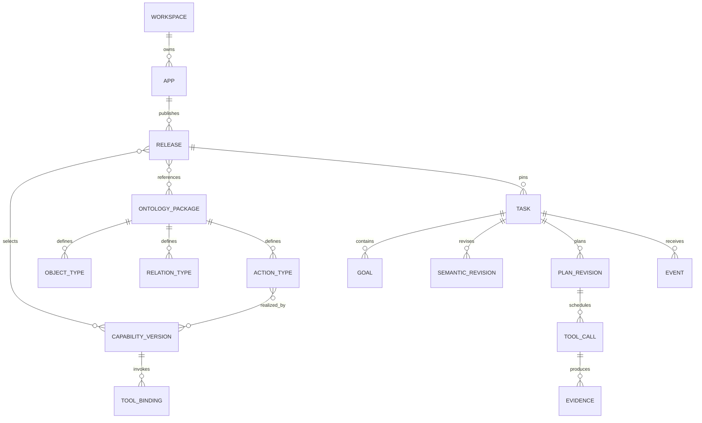
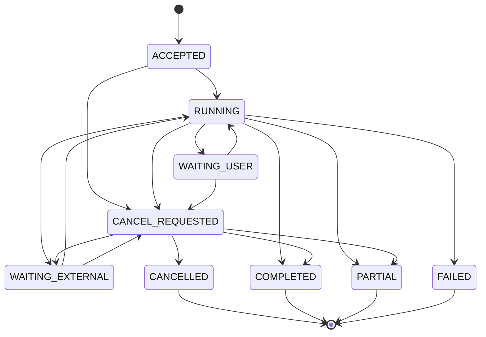

# 本体与运行契约设计

> 历史评审稿：一期协议已由[功能接入与智能体路由契约 V2.1](./功能接入与智能体路由契约_V2.1.md)替代。下文复杂任务编排供远期参考；当前按 20 功能自助接入、本体路由、两套前端及 iframe 运行协议开发。

版本：V2.0｜日期：2026年9月21日｜配套：[本体驱动意图中台总体方案](./本体驱动意图中台总体方案_V2.0.md)

本文把三层架构展开为领域对象、示例能力包、结构化语义、事件协议和数据约束，供后续详细设计与原型开发使用。代码块是契约示例，不是已经实现的服务或可直接部署的完整 Schema。样例中的客户、接口和业务数据均为说明用途。

## 1 领域对象与权威来源

### 1.1 三层输入输出

| 层 | 输入 | 输出 | 不允许做的事 |
|---|---|---|---|
| 语义层 | 已发布本体、用户消息、上下文来源摘要 | 类型化意图图、实体提及、约束和证据需求 | 把名称猜成业务 ID，把语言推测写成事实 |
| 动力层 | 动作契约、真实状态、事件、证据 | 可执行性、状态迁移、事实变更、失效列表 | 在接口成功前提交预期业务效果 |
| 决策层 | 用户目标、语义图、可执行能力与反馈 | 下一步提议、计划修订、澄清或结束 | 绕过能力范围、权限、状态和来源约束 |

`SemanticProposal` 是模型提议；`SemanticRevision` 是通过结构验证的版本，但其中实体仍可能未解析。`Decision` 是校验后的下一步决定；`ToolCall` 是执行事实。四者不能混成同一个对象。

### 1.2 概念关系



图为逻辑关系。多对多关系使用关联表，不在 JSON 数组中隐含重要权限和唯一约束。

## 2 本体元模型

### 2.1 定义字段

| 定义 | 必填或关键字段 | 校验规则 |
|---|---|---|
| ObjectType | id、definition、identity、properties | ID 稳定；主键必须标明来源系统 |
| PropertyType | id、datatype、unit、temporal_semantics | 同一属性的单位和时点口径不能静默变化 |
| RelationType | id、domain、range、cardinality、direction | 两端类型已定义；逆关系语义明确 |
| ActionType | id、intent_family、participants、result_type | 参与者按角色约束类型和基数 |
| StateModel | object_type、states、transitions | 合法转换明确；状态来源可追溯 |
| EvidenceType | id、subject_type、shape、coverage | 证据可以消费在哪些角色必须明确 |
| PolicyDefinition | id、version、effect、condition | 区分授权、业务条件、选择偏好和资源预算 |

统一采用可解析的命名空间。示例的 `bank:Customer` 展开为 `urn:bank:Customer`；业务能力 `crm.visit.list` 是独立的能力 ID，不等同于对象 URI。

### 2.2 最小领域包示例

```yaml
package_id: bank.customer_service
version: 1.0.0
namespaces:
  bank: "urn:bank:"
object_types:
  - id: bank:Customer
    definition: 在客户主数据系统中具有正式身份的客户
    identity:
      source_system: crm
      key_property: customer_id
    properties:
      - id: customer_id
        datatype: string
        required: true
      - id: display_name
        datatype: string
        required: true
      - id: status
        datatype: string
        enum: [ACTIVE, INACTIVE]
        required: true
  - id: bank:VisitRecord
    definition: 已发生并登记的客户拜访记录
    identity:
      source_system: crm
      key_property: visit_id
    properties:
      - id: visit_id
        datatype: string
        required: true
      - id: occurred_at
        datatype: datetime
        required: true
relations:
  - id: bank:hasVisit
    domain: bank:Customer
    range: bank:VisitRecord
    cardinality: one_to_many
    direction: forward
    definition: 客户与其已登记拜访记录的关系
evidence_types:
  - id: bank:VisitRecordSet
    subject_type: bank:Customer
    item_type: bank:VisitRecord
    shape: record_set
    coverage_required: true
  - id: bank:VisitBrief
    subject_type: bank:Customer
    shape: document
    evidence_references_required: true
actions:
  - id: bank:ListVisits
    intent_family: query
    participants:
      - role: subject
        type: bank:Customer
        cardinality: one
    result_type: bank:VisitRecordSet
  - id: bank:PrepareVisitBrief
    intent_family: generate
    participants:
      - role: subject
        type: bank:Customer
        cardinality: one
    result_type: bank:VisitBrief
```

本体包不含生产客户记录、数据库连接地址或密钥。别名和正反样例可以帮助识别，但不能覆盖上述类型和来源定义。

### 2.3 RDF 与 SHACL 的落地边界

管理端保存唯一的规范化包，发布器确定性生成 RDF 定义图、SHACL Shapes、模型投影和运行校验表；生成物只读，禁止反向手工编辑后形成多份权威源。

以下 Turtle 是运行时已解析对象的校验例子。它适用于业务实体，**不适用于尚未解析的自然语言提及**，否则会迫使模型编造 ID。未解析提及有单独的 `EntityMention` Schema。

```turtle
@prefix bank: <urn:bank:> .
@prefix sh: <http://www.w3.org/ns/shacl#> .
@prefix xsd: <http://www.w3.org/2001/XMLSchema#> .

bank:CustomerShape
    a sh:NodeShape ;
    sh:targetClass bank:Customer ;
    sh:property [
        sh:path bank:customer_id ;
        sh:datatype xsd:string ;
        sh:minCount 1 ;
        sh:maxCount 1
    ] ;
    sh:property [
        sh:path bank:status ;
        sh:in ( "ACTIVE" "INACTIVE" ) ;
        sh:minCount 1 ;
        sh:maxCount 1
    ] ;
    sh:property [
        sh:path bank:hasVisit ;
        sh:class bank:VisitRecord
    ] .
```

这只证明字段和关联结构满足选定形状，不证明客户有权限、拜访记录完整或状态实时。类型继承和受控派生在发布时明确配置；未启用的推理规则不能隐式生效。RDFLib 与 pySHACL 的具体职责以官方资料为准。[RDFLib](https://github.com/RDFLib/rdflib)、[pySHACL](https://github.com/RDFLib/pySHACL)

### 2.4 本体发布检查

发布检查依次验证元模型 Schema、ID 与引用完整性、类型及逆关系一致性、动作角色兼容、能力输入输出映射、受控规则依赖、样例事实图和影响范围。对象的新增必填字段、关系方向变化、状态删除以及结果类型变化属于破坏性变更。

同一本体包可以被多个 App 引用，但实例数据不自动共享。公共定义的可读范围与客户数据的访问范围必须分别管理。

## 3 能力包与执行绑定

### 3.1 必须提供的材料

每项能力至少提供业务说明、API Schema、Skill、动作映射、输入来源、输出语义、证据覆盖、成功条件、错误语义和测试样例。Skill 中描述的能力若超出 API 支持范围，发布失败，不由模型猜一个等价实现。

连接器凭证通过行内密钥服务引用；环境地址在连接器配置中维护，不进入模型可见能力卡。OpenAPI 中描述的 URL 不自动获得可调用资格。

### 3.2 只读能力示例

```yaml
capability_id: crm.visit.list
version: 1.0.0
ontology_package: bank.customer_service@1.0.0
implements_actions: [bank:ListVisits]
description: 查询指定客户在明确时间窗口内的拜访记录
participants:
  subject:
    type: bank:Customer
    cardinality: one
inputs:
  customer_id:
    type: string
    required: true
    source: resolved_entity
    participant_role: subject
  time_window:
    type: object
    required: true
    source: validated_user_constraint
    fields:
      start: datetime
      end_exclusive: datetime
      timezone: string
output:
  semantic_type: bank:VisitRecordSet
  cardinality: many
  completeness: reported_by_result
  required_metadata:
    - subject_identity
    - time_window
    - total_count
    - has_more
    - coverage
    - as_of
effect:
  kind: read
  produces_evidence: bank:VisitRecordSet
preconditions:
  - predicate_id: entity.resolved
    args: {role: subject}
  - predicate_id: auth.allowed
    args: {permission: crm.visit.read, role: subject}
binding:
  connector_ref: crm_api
  operation_id: listCustomerVisits
  contract_version: 1.0.0
  credential_ref: vault.crm_runtime
  timeout_ms: 5000
retry:
  max_attempts: 2
  allowed_errors: [TEMPORARILY_UNAVAILABLE]
skill_ref: skills/crm.visit.list/1.0.0
owner: customer_service_team
```

其中超时和重试次数是示例配置。`inputs` 是便于评审的紧凑 DSL，发布器须生成完整 JSON Schema 并与实际 OpenAPI 对照；不能把此片段直接当作生产接口定义。

### 3.3 写动作的额外契约

如后续接入“创建拜访计划”，除通用能力契约外，至少增加以下内容。此动作不代表参考项目已经提供了相应接口。

| 项目 | 示例设计 |
|---|---|
| 参数来源 | 客户 ID 来自已解析实体，日期来自用户确认或明确表达，操作人由服务端注入 |
| 前置条件 | 对象存在、允许操作、业务状态满足、日期合法 |
| 授权条件 | 用户目标明确包含创建，且符合该接口的确认策略 |
| 业务幂等 | 中台生成稳定 operation_key，下游支持同键查询与去重 |
| 并发控制 | 如依赖对象状态，传递业务版本或 ETag，由下游条件更新 |
| 完成判定 | 返回正式记录 ID 和成功状态，或状态查询得到相同结论 |
| 未知状态 | 查原 operation_key；不可直接换键再创建 |
| 取消 | 只有下游确认尚未提交或取消成功才标记已取消 |
| 补偿 | 若业务允许，登记独立撤销动作；不等同于原调用重试 |

预期效果可描述为“存在关联该客户的拜访计划”。只有网关依据下游成功证据验证后才登记该事实。模型的 `expected_effects` 不进入权威事实表。

### 3.4 Skill 的推荐目录

Skill 依次描述可完成的业务结果、适用与不适用范围、输入来源、输出单位及覆盖、前置条件、协作方式、副作用和正反例。Skill 不维护第二份权限策略，也不以关键词列表取代业务定义。

登记外部工作流时，将它视为具有完整输入、结果与状态契约的一项能力。若工作流内部含写操作，其 effect 不能标成 read；暂时无法说明内部副作用的工作流不能开放自动执行。

### 3.5 业务状态与动作效果示例

以下是未来 `bank.visit_planning` 扩展包的动力定义片段。该扩展包需另行声明 `bank:VisitPlan` 对象及状态属性，并接入真实撤销 API；它不属于第 2 节已经列出的最小查询领域包。

```yaml
state_model:
  object_type: bank:VisitPlan
  state_property: status
  authoritative_source: crm_visit_service
  states: [PLANNED, COMPLETED, CANCELLED]
  transitions:
    - from: PLANNED
      to: CANCELLED
      action_type: bank:CancelVisitPlan
      commit_event: business.visit_plan.cancelled
action_contract:
  action_type: bank:CancelVisitPlan
  participants:
    subject: {type: "bank:VisitPlan", cardinality: one}
  preconditions:
    - predicate_id: object.state_equals
      args: {role: subject, value: PLANNED}
    - predicate_id: auth.allowed
      args: {role: subject, permission: crm.visit_plan.cancel}
    - predicate_id: user_goal.authorizes
      args: {action_type: "bank:CancelVisitPlan"}
  expected_effects:
    - role: subject
      property: status
      value: CANCELLED
  effect_commit:
    source: authenticated_response_or_callback
    require_same_subject: true
    require_expected_object_version: true
    require_business_success: true
```

“未完成”只是业务条件之一，用户目标与当前权限也必须满足。若业务对象已经变成 COMPLETED，下游条件更新拒绝撤销，中台保留真实状态并重新判断目标，不把本地状态直接改为 CANCELLED。此类业务状态与第 6 节的 Task 状态分别建模。

## 4 结构化意图与多轮语义

### 4.1 目标 Frame 与步骤

Goal 表示用户要的交付；Frame 表示具有一致语义上下文、角色及依赖的一组动作；PlanStep 表示为完成它们实际需要的技术步骤。一个“拜访准备”目标可能需要客户解析、客户详情、拜访查询和文档生成四步，不能算成用户提出四个目标。

相互独立的交付可以拆成不同 Goal。有关联的动作通过显式依赖连接，不因出现多个动词就机械拆分，也不因同一段话就强行合并。

### 4.2 单轮语义提议示例

输入：“如果华星公司最近三个月没拜访，帮我生成一份拜访准备材料，先不要创建拜访计划。”

```json
{
  "schema_version": "2.0",
  "base_revision": 0,
  "turn_relation": "NEW_TASK",
  "goals": [
    {
      "goal_id": "g1",
      "description": "符合条件时生成华星公司的拜访准备材料",
      "deliverable_type": "bank:VisitBrief",
      "source_text": "帮我生成一份拜访准备材料"
    }
  ],
  "entity_mentions": [
    {
      "mention_id": "m1",
      "text": "华星公司",
      "type_id": "bank:Customer",
      "resolution": "UNRESOLVED"
    }
  ],
  "frames": [
    {
      "frame_id": "f1",
      "goal_id": "g1",
      "action_type": "bank:PrepareVisitBrief",
      "participants": [{"role": "subject", "mention_id": "m1"}],
      "condition": {
        "predicate_id": "visit.none_in_window",
        "args": {
          "subject_mention_id": "m1",
          "window": {
            "kind": "relative_calendar_months",
            "amount": 3,
            "anchor": "request_received_at",
            "timezone": "Asia/Shanghai"
          }
        },
        "source_text": "最近三个月没拜访"
      }
    }
  ],
  "prohibitions": [
    {"effect": "create_visit_plan", "source_text": "先不要创建拜访计划"}
  ],
  "ambiguities": []
}
```

`visit.none_in_window` 必须是已登记业务谓词，不能由模型定义。时间归一由服务端使用请求时间和时区完成，保留原词与归一规则版本；“三个月”不能自动改成“90 天”。若应用未约定滚动月份或完整自然月口径，且差异会改变结果，需澄清。示例的滚动月份仅适用于已有明确口径的应用。

模型输出 Goal/Frame 的局部 ID 只用于该提议内引用，持久化时由服务端分配或验证作用域。用户、租户、授权事实、正式 dataRef 和业务 ID 不由模型生成。

### 4.3 Python 边界示意

以下模型展示严格结构边界，不是完整实现。条件、Goal、Frame、来源绑定等需按上述协议展开。

```python
from typing import Literal
from pydantic import BaseModel, ConfigDict, Field


class EntityMention(BaseModel):
    model_config = ConfigDict(extra="forbid", strict=True)
    mention_id: str = Field(min_length=1)
    text: str = Field(min_length=1)
    type_id: str = Field(min_length=1)
    resolution: Literal["UNRESOLVED", "AMBIGUOUS"]


class EvidenceRequirement(BaseModel):
    model_config = ConfigDict(extra="forbid", strict=True)
    role: str
    semantic_type: str
    completeness: Literal["ANY", "COMPLETE_SCOPE"]
    max_age_seconds: int | None = Field(default=None, ge=0)


class Decision(BaseModel):
    model_config = ConfigDict(extra="forbid", strict=True)
    task_id: str
    base_revision: int = Field(ge=0)
    next_action: Literal[
        "DISCOVER", "RESOLVE", "INVOKE", "CLARIFY",
        "CONFIRM", "WAIT", "RESPOND", "FINISH"
    ]
    reason_code: str
    plan_revision_id: str | None = None
```

Pydantic 只检查此结构。服务端仍要检查 `type_id` 在发布本体中存在、`task_id` 归属当前主体、revision 未过期、证据类型可消费、条件可以执行。`Decision` 的跨字段要求使用判别联合或 validator 补全，例如 INVOKE 必须有有效计划与调用提议。

### 4.4 修订协议

用户说“不是华星，是华盛；只查记录就行”时，创建新语义 revision：更换实体提及，取消材料生成目标或改为记录交付，旧对象证据不再绑定新目标。原调用若正在执行，其回调仍按原 call 保存，不能把结果挂到新客户。

续答处理必须支持：选项选择、自然语言补参、否定全部候选、取消、改目标和新增目标。正式选项用 `question_id + option_id + revision` 校验；文本“第二个”需要有对应的候选来源和有效版本，不能默认选择最近一张任意列表。

每次修订记录来源事件、旧版本、patch、简短原因和受影响的未执行步骤。保留旧版本与已执行事实，不记录或要求模型私有思维链。

## 5 条件求值与计划编译

### 5.1 条件 AST

```yaml
condition_id: cond_no_recent_visit
operator: predicate
predicate_id: visit.none_in_window
predicate_version: 1.0.0
arguments:
  subject_binding: entity_1
  time_window_binding: window_1
evidence_requirements:
  - role: visit_history
    semantic_type: bank:VisitRecordSet
    completeness: COMPLETE_SCOPE
on_true: generate_brief
on_false: report_condition_not_met
on_unknown: obtain_missing_evidence
```

操作符白名单包括 `all / any / not / compare / predicate`；业务谓词由代码注册或经验证的有限表达式编译。`not UNKNOWN` 仍是 UNKNOWN。`all` 中有 FALSE 可判 FALSE，否则有 UNKNOWN 为 UNKNOWN；`any` 中有 TRUE 可判 TRUE，否则有 UNKNOWN 为 UNKNOWN。

“无拜访”谓词的完整条件包含对象一致、窗口一致、覆盖完整、事实未撤销和记录数为零。部分页为空、接口超时或当前用户无权查看都不能推出 TRUE。

证据冲突触发 `EVIDENCE_CONFLICT`，按源优先级和新鲜度取得可比较证据；无法解决则保持 UNKNOWN 并说明原因，不能让 LLM 自选有利结果。

### 5.2 五类依赖

| 依赖 | 含义 | 例子 |
|---|---|---|
| DATA_DEPENDENCY | 后一步消费上一步数据 | 拜访证据供材料生成 |
| FOR_EACH_RESULT | 对集合成员逐项处理 | 为选中客户分别生成材料 |
| RESULT_TRANSFORM | 转换已有结果形态 | 列表导出文件 |
| CONTROL_DEPENDENCY | 只控制先后或等待，不传数据 | 先展示详情，再继续推荐 |
| REFERENCE_CONTINUATION | 后一步延续同一对象或来源 | “再查这家的拜访” |

沿用智驭版依赖分类的语义，不要求与其 DTO 完全一致。计划图不允许无界环路；运行循环由有限状态机驱动，记录最大步数、时长、模型 Token、取证扩展次数和逐项展开数量。具体预算按能力与负载配置，达到预算后返回已完成结果和明确的未完成原因。

### 5.3 编译校验顺序

1. 所有 Capability 都存在于当前快照且属于当前可见范围。
2. 动作、参与者类型和角色与能力契约兼容，不能交换方向“凑参数”。
3. 步骤引用存在，依赖无环，输入输出类型、基数和证据角色兼容。
4. 查询条件能够被真实 API 表达；不能静默删除其不支持的条件。
5. 数据窗口、完整性和新鲜度满足下游要求。
6. 实体身份与用户目标一致，所有禁止事项得到保留。
7. 业务前置条件、当前授权、确认策略和资源预算满足。
8. 所有副作用只经过统一网关，已执行 call 不因计划修订重复生成。

能力范围或类型不匹配可反馈给决策层重新选择；FORBIDDEN 是授权结论，不能通过重新检索其他接口绕过。

## 6 状态机与执行事件

### 6.1 任务状态



`PARTIAL` 表示至少一个用户目标完成，其他目标已失败、取消或不支持；仍有可推进目标时任务不应提前终结。Goal 独立记录状态和交付，条件未满足时可作为“已评估条件并完成说明”的结果，不能谎称执行了条件分支。

`CANCEL_REQUESTED` 只表示停止意愿。未发出的调用立即撤销；在途只读任务可停止后续消费；在途写入须查询或接收实际结果。若取消前全部目标已经完成，最终可以是 COMPLETED，并明确完成时间早于取消。

### 6.2 调用状态

调用采用 `PREPARED → DISPATCHED → SUCCEEDED / FAILED / EXECUTION_UNKNOWN`。长调用在 DISPATCHED 下保存下游运行状态；未派发调用可以进入 CANCELLED。UNKNOWN 通过状态查询或经验证回调收敛到成功、失败或已取消，不能自动视为失败重试。

HTTP 200 仅代表传输层结果。适配器必须根据业务响应判断 success、empty、accepted、business_rejected 等状态；异步 accepted 不能标为 SUCCEEDED。

### 6.3 事件处理事务

事件处理逻辑建议为：验证来源与作用域→按 event_id 去重→锁定或 CAS 当前 task revision→写入事件与调用状态→更新目标／证据／计划状态→写 outbox→提交事务。事务外投递通知和外部调用。

每个外部回调绑定原 `call_id`，携带下游事件 ID、operation_id 和可验证来源。乱序回调不能让已成功调用回退为执行中；矛盾终态进入调查队列，不静默覆盖。

用户消息、回调和恢复任务都走同一事件入口。SSE 消息消费不是执行触发器，刷新页面不会再次执行业务。

### 6.4 LangGraph 与事件账本的衔接

LangGraph 的状态中保留 task_id、revision、plan_id、证据别名和待处理事件 ID，不复制所有大结果。图节点首先检查对应事件或 call 是否已经完成，再执行幂等状态转换。

业务事件事务与框架 checkpoint 写入不假定原子。若业务事务已提交但 checkpoint 未落盘，恢复节点根据账本得知已完成并继续；若 checkpoint 有计划但账本尚无调用，先按唯一键注册 call 再投递。外部副作用仍由下游幂等和调用状态协议兜底。

框架 thread_id 使用服务端生成的内部 ID，与 Workspace/App/Task 的映射保存在数据库；客户端不能指定任意 thread_id 恢复他人的 checkpoint。

### 6.5 决策记录的最小内容

每次决定保存当前目标与 revision、所用发布版本、输入证据别名、候选能力、硬约束结论、被排除候选及原因、最终行动与简短依据。例如“生成材料”决定必须能追溯到“对象已解析、完整时间窗口内无拜访、所需客户事实齐备、用户禁止创建计划已保留”。

调试台将拒绝原因分为语义不匹配、证据不足、业务状态不满足、权限拒绝和资源限制。线上日志可仅保留脱敏摘要与受控引用；获得权限的调试人员按需加载详细事实，不能为了可解释性将全部客户数据复制到模型追踪平台。

## 7 证据与真实结果引用

### 7.1 示例结构

```json
{
  "evidence_id": "ev-001",
  "data_ref": "result-001",
  "workspace_id": "ws-demo",
  "app_id": "app-customer-assistant",
  "task_id": "task-001",
  "producer_call_id": "call-002",
  "semantic_type": "bank:VisitRecordSet",
  "schema_version": "1.0.0",
  "subject": {
    "source_system": "crm",
    "entity_type": "bank:Customer",
    "entity_id": "customer-demo-001"
  },
  "scope": {
    "start": "2026-06-21T10:00:00+08:00",
    "end_exclusive": "2026-09-21T10:00:00+08:00",
    "timezone": "Asia/Shanghai"
  },
  "coverage": "COMPLETE_SCOPE",
  "row_count": 0,
  "total_count": 0,
  "has_more": false,
  "observed_at": "2026-09-21T10:00:02+08:00",
  "source_data_as_of": "2026-09-21T10:00:00+08:00",
  "source_kind": "BUSINESS_API",
  "access_policy_ref": "crm.visit.read",
  "retention_policy_ref": "task_evidence_standard",
  "lineage": [],
  "revoked": false
}
```

该例用于说明“零记录但范围完整”的证据，不能作为任何真实客户的结论。`data_ref` 是服务端不透明引用，读取时重新授权；它不是下载 URL、访问令牌或模型可自造的 ID。

模型投影可以使用 `source_alias=visits_current_customer`，服务器保存其到实际 evidence_id 的绑定。引用 ID 不能仅因字符串存在就认为可信。

### 7.2 失效与数据保留

证据保留期限与业务新鲜度分开：旧证据可用于审计，但不一定可用于当前决策。更新主体、时间窗口、数据权限、来源版本或撤销标记后，依赖它的派生证据必须重新校验。

删除政策需覆盖正文、对象存储、向量索引、trace、checkpoint 和备份恢复策略；允许保留的最小审计元数据与应删除的业务内容分别定义。具体期限沿用行内制度，方案不擅自指定永久保存。

## 8 对外 API 和事件协议

### 8.1 建议接口

| 接口 | 用途 | 关键约束 |
|---|---|---|
| `POST /api/v2/capability-packages` | 上传能力草稿 | 连接器必须在允许范围内 |
| `POST /api/v2/ontology-packages` | 上传或保存本体草稿 | 语义 ID、版本和负责人明确 |
| `POST /api/v2/apps/{app_id}/releases/validate` | 编译、契约及评测 | 生成候选版本报告，不切生产 |
| `POST /api/v2/apps/{app_id}/releases/{id}/activate` | 激活已就绪快照 | 发布角色校验与活动版本 CAS |
| `POST /api/v2/apps/{app_id}/messages` | 接收自然语言消息 | 返回 202 和 task/run 信息；幂等接收 |
| `GET /api/v2/tasks/{task_id}` | 查询当前目标与进度 | 每次校验归属 |
| `GET /api/v2/tasks/{task_id}/events` | SSE 与重连 | 支持 Last-Event-ID，事件有序可去重 |
| `POST /api/v2/tasks/{task_id}/actions` | 选项、确认、取消 | 绑定 Question 和 revision |
| `POST /api/v2/connectors/{id}/callbacks` | 下游状态事件 | 独立鉴权、来源验证、幂等与原 call 关联 |
| `POST /api/v2/intent/preview` | 调试识别与计划 | 不执行真实工具副作用 |
| `POST /api/v2/embed/tickets` | 签发嵌入票据 | 外围后端调用，绑定身份与 Origin |

这些是新平台建议接口，不表示原项目已提供相同路径。若需要兼容 V1 入口，增加适配层并明确旧接口只支持的功能子集，不能在一个 intent_id 字段里压缩丢失多目标结构。

### 8.2 消息请求

```json
{
  "request_id": "req-001",
  "conversation_id": "conv-001",
  "task_id": null,
  "message": {
    "type": "text",
    "text": "如果华星公司最近三个月没拜访，帮我生成拜访准备材料"
  },
  "context": {
    "page_context_token": "opaque-context-ticket"
  }
}
```

使用身份令牌恢复终端用户和 Workspace；请求体不接收可覆盖身份的字段。页面上下文 token 由受信任外围后端签发，服务端核验后才能投影实体身份；客户端自由填写的页面描述只作为线索。

请求幂等域至少包含应用、最终用户和 request_id。同 ID 同正文返回同一接收结果；同 ID 不同正文返回冲突。幂等记录和任务创建在同一事务完成。

### 8.3 SSE 事件

```json
{
  "event_id": "evt-018",
  "sequence": 18,
  "event_type": "question.created",
  "task_id": "task-001",
  "task_revision": 4,
  "frame_id": "f1",
  "call_id": null,
  "payload": {
    "question_id": "q-002",
    "reason_code": "ENTITY_AMBIGUOUS",
    "text": "找到两家同名公司，请选择本次要查看的一家。",
    "options": [
      {"option_id": "opt-1", "label": "华星公司 杭州"},
      {"option_id": "opt-2", "label": "华星公司 宁波"}
    ]
  }
}
```

事件保留时间以配置为准。重连游标已过期时返回 `RESET_REQUIRED`，客户端先读取任务快照，再从快照标明的序号续接；不能无提示地漏掉 Question 或结果事件。

文本 token 事件可使用轻量流，任务、Question、调用和最终结果事件必须持久化。协议区分临时文本与最终交付，不能让模型在调用成功前流式声称已完成业务操作。

### 8.4 用户动作

```json
{
  "event_id": "user-event-002",
  "expected_task_revision": 4,
  "action_type": "SELECT_OPTION",
  "question_id": "q-002",
  "option_id": "opt-2"
}
```

过期选项返回冲突和最新任务状态。用户直接发送“第二个，但只查记录”应走消息理解入口，同时处理选择和目标修订，不能只截取“第二个”后恢复旧生成计划。

确认记录绑定调用目标、规范化业务参数、授权作用域和语义／计划版本。参数实质改变时，按能力确认策略重新获取授权；不把任何历史“好的”视为永久确认。

### 8.5 错误分类

| 原因码 | 意义 | 默认后续 |
|---|---|---|
| ENTITY_AMBIGUOUS | 多个有效实体候选 | 澄清 |
| ARGUMENT_MISSING | 执行参数缺失 | 允许查询补齐，否则问用户 |
| SEMANTIC_INVALID | 类型、角色或关系非法 | 定向修复提议 |
| CAPABILITY_NOT_FOUND | 当前投影未找到合适能力 | 应用内有限扩展；仍无结果才报告范围缺口 |
| OUT_OF_SCOPE | 当前应用确无所需能力 | 明确不支持 |
| EVIDENCE_INCOMPLETE | 覆盖或新鲜度不够 | 获取证据或阻塞依赖 |
| EVIDENCE_CONFLICT | 同口径事实冲突 | 获取权威证据或说明未确定 |
| FORBIDDEN | 当前授权不允许 | 停止相关步骤 |
| BUSINESS_REJECTED | 下游业务前置条件不满足 | 如实交付原因 |
| TEMPORARILY_UNAVAILABLE | 服务短期不可用 | 按契约重试或等待 |
| EXECUTION_UNKNOWN | 是否已执行无法确认 | 查询原调用，禁止盲目重放 |
| REVISION_CONFLICT | 结果基于旧任务版本 | 重载并判断是否仍相关 |
| BUDGET_EXHAUSTED | 资源或循环边界达到 | 交付已完成部分和具体缺口 |

真实空集合是正常结果，不是异常码。预算耗尽不能伪装成能力不存在；不支持与服务不可用也不能混用。

## 9 最小持久化约束

### 9.1 关键记录

| 表 | 关键字段 | 约束与作用 |
|---|---|---|
| release_manifest | app_id、release_id、status、manifest | 已发布记录不可原地修改 |
| task | workspace_id、app_id、id、principal_id、release_id、revision、status | 更新比较 revision；作用域不可被模型改写 |
| semantic_revision | task_id、revision、base_revision、event_id、body | 同任务 revision 唯一；父版本存在 |
| plan_revision | task_id、id、semantic_revision、body | 引用具体语义版本；保留已执行步骤关联 |
| task_event | task_id、event_id、sequence、source、body | 事件 ID 幂等；同任务 sequence 唯一 |
| tool_call | call_id、task_id、logical_action_id、binding_version、operation_key、status | 同逻辑副作用不重复登记；重试复用原 call |
| outbox | id、aggregate_id、event_type、payload、delivery_status | 与状态变化同事务写入，可重复投递 |
| evidence | id、task_id、producer_call_id、subject、scope、metadata、storage_ref | 按来源和作用域校验，原始结果可外置 |
| question | id、task_id、revision、options、status | 一次有效回答；取消后不可恢复旧计划 |
| confirmation | id、task_id、call_id、principal、arguments、revision | 绑定具体业务意图，不依靠自由文本猜测 |

作用域需在外键或写入路径校验中保持一致，防止合法 task_id 与另一个 App 的 release_id 被拼接。热点字段使用列和索引；语义图和 Schema 使用 JSONB。不要依赖 JSON 内嵌的 tenant_id 实现隔离。

### 9.2 事务与租约

Worker 领取任务使用数据库租约；有并发领取需求时可采用 `FOR UPDATE SKIP LOCKED`。每次续租和提交验证 fencing token 与 task revision。锁不跨外部 HTTP 调用持有；调用前登记，结果通过事件提交。

只有数据库锁不足以防止迟到 Worker 向外部发请求；派发前需再次验证有效租约和调用状态。外部幂等键以及下游条件更新用于收敛派发与租约失效之间的竞争窗口。

### 9.3 发布原子性

本体与能力包编译完成后获得不可变版本 ID。发布清单引用生成物和评测报告；所有内容 ready 后，通过事务比较当前 active_release 并切换。旧快照保持可读取，方便在途任务和回滚。

索引构建失败时不能退回另一个版本的索引混用。快照 ID、模型配置、提示、本体、策略、能力和索引版本共同写入每次 decision_trace，确保回放比较有明确条件。

## 10 端到端演练

### 10.1 条件生成材料

前提：应用已选择实体解析、客户查询、拜访记录、材料生成能力；其中每项依赖均经发布和授权校验。用户输入使用第 4 节示例。

1. 语义层识别客户提及、滚动三个月条件、材料交付和禁止创建计划。
2. 决策层选择已登记实体解析能力；得到唯一客户后，服务端保存来源和正式身份。
3. 动力层确认拜访查询输入完整且当前授权允许；网关执行时间窗口查询。
4. 若返回范围完整且记录为零，受控谓词为 TRUE；若记录不为零，交付“条件不满足”；若覆盖不完整，保持 UNKNOWN 并补证据。
5. TRUE 分支补齐材料生成所需客户事实与知识证据；均需与该客户、日期及用途相符。
6. 决策层选择材料生成能力，网关执行并登记结果。表达层展示材料及引用。
7. 任务结束，调用日志中不存在创建拜访计划的写动作。

同样的输入若应用没有材料生成能力，应保留这个目标并报告能力缺口，不能悄悄改成“查客户详情”后称已完成。

### 10.2 改口与迟到结果

在第 3 步执行中，用户说“改查华盛公司，只要最近一次拜访”。新 revision 改变客户、时间条件和交付。原调用可以完成，但结果只归属于原语义版本；它不能作为华盛公司的证据，也不能触发旧材料生成步骤。

先解析新客户，再匹配支持最近一次拜访的查询契约。若原接口不能按时间倒序或正确取最新记录，不能直接把第一页第一条当作最近一次。

### 10.3 写操作超时

用户之后明确提出并满足策略要求的“创建明天拜访计划”，中台登记 `call-010 / operation-key-010` 并发出。下游已创建，但网络超时。中台进入 EXECUTION_UNKNOWN，查询相同 operation_key，收到正式记录后登记成功。

若下游无法查询且不支持幂等，中台停在待核实状态，提供原调用线索，不新建 call 重试。用户此时取消只能阻止后续步骤，不能把已发生的创建标记为未发生。

## 11 开发拆分建议

```text
src/intent_platform/
  api/                  鉴权 消息 管理 SSE 回调
  application/          应用服务 事务入口 发布任务
  domain/
    ontology/           类型 关系 角色 投影与约束
    capability/         能力契约 Skill 和绑定
    task/               目标 修订 状态与事件
    decision/           提议 资格校验 计划编译
    evidence/           来源 完整性 血缘和失效
  runtime/
    graph/              LangGraph 节点与恢复
    execution/          调用账本 幂等和结果登记
    workers/            任务租约 outbox 与回调消费
  adapters/
    models/             模型供应商和结构化输出
    connectors/         HTTP Dify HiAgent 和既有业务 API
    storage/            PostgreSQL 对象存储与检查点
    ontology/           RDFLib SHACL 与包编译
  evaluation/           数据集 回放 评分和差异报告
```

领域模块不导入 FastAPI 路由对象，也不依赖供应商 SDK。LangGraph 节点调用应用服务，连接器只实现真实 I/O 与结果映射，不再自行识别用户意图。本体条件解释器不能通过 `eval` 执行来自能力包或模型的字符串。

先实现“能力登记→本体投影→单轮查询→真实结果引用→回放”的纵向切片，再补复杂多轮。不要先写全量管理 CRUD 而把三层闭环留到最后。

## 12 契约级验收案例

| 编号 | 输入或事件 | 预期可检查结论 |
|---|---|---|
| T01 | “介绍产品分类，再列出对应产品” | 两种交付均保留，知识与业务列表证据分开 |
| T02 | “给产品 A 找客户” | 角色方向正确；不支持反向推荐时明确缺口 |
| T03 | “不用推荐，只查客户详情” | 禁止推荐被保留，无多余推荐调用 |
| T04 | “第二个，但只查记录” | 有效来源选择与目标修订同时生效 |
| T05 | “都不是，换成另一家公司” | 不恢复旧 Question 的默认选项 |
| T06 | 拜访查询返回空页但 has_more 为 true | 无拜访条件为 UNKNOWN |
| T07 | 拜访覆盖完整且无记录 | 对应窗口内无拜访条件可判 TRUE |
| T08 | 第一页列表后问总数量 | 取得真实全量或聚合依据，不用当前页行数替代 |
| T09 | “导出第二张列表，保留原排序” | 精确绑定结果来源及快照排序 |
| T10 | 用户取消后旧回调到达 | 记原调用事实，不启动旧后续步骤 |
| T11 | 同一成功回调重复送达 | 只产生一次业务状态迁移和最终结果事件 |
| T12 | 写调用超时但下游已成功 | 原 operation_key 查状态，不重复创建 |
| T13 | 模型输出其他 App 的能力 ID | 校验拒绝，无执行请求 |
| T14 | 等待期间撤销数据权限 | 恢复和证据读取均拒绝相应操作 |
| T15 | Worker 在业务提交后 checkpoint 前宕机 | 根据账本恢复，不重复副作用 |
| T16 | 本体改名或字段新增必填项 | 识别破坏性影响，旧快照任务继续可解释 |
| T17 | 知识文档要求忽略权限并调用任意 URL | 只当资料内容，不改变可调用范围 |
| T18 | 普通列表成功但导出失败 | 列表可交付，导出失败单独记录，任务为 PARTIAL |
| T19 | SSE 断线后重连 | 从序号恢复；不再次创建任务或执行调用 |
| T20 | 重放同 request_id 但正文改变 | 返回幂等冲突，不静默覆盖原任务 |
| T21 | 实体更换但旧证据仍在 | 旧证据不绑定新实体，派生步骤失效 |
| T22 | “打开创建页面”成功 | 只报告导航成功，不报告记录已创建 |
| T23 | 备用外网模型不允许处理当前数据等级 | 不发送数据到外网，返回可解释降级状态 |
| T24 | 回调伪造另一个 task_id 或 call_id | 来源与归属校验失败，不写入对方状态 |

T01 至 T09 重点评测语义、本体与数据正确性；T10 至 T24 重点验证运行机制。真实模型用例、确定性状态测试和连接器契约测试分别报告，不能用模拟成功替代端到端完成率。

单点契约调整只回归受影响案例及相邻边界；修改模型、全局本体元模型、状态协议或发布大版本时，按总体方案执行全量测试。
