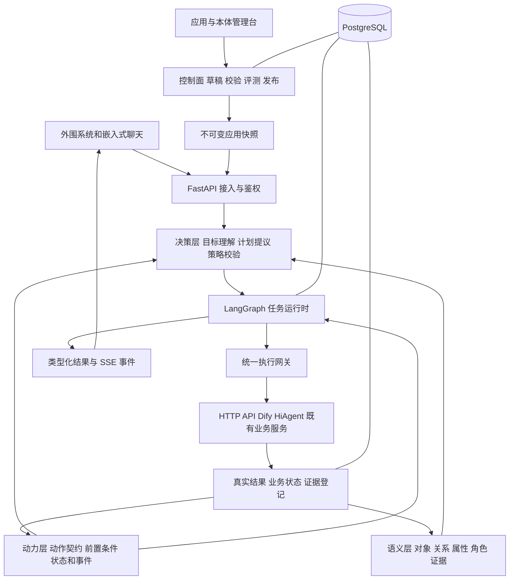
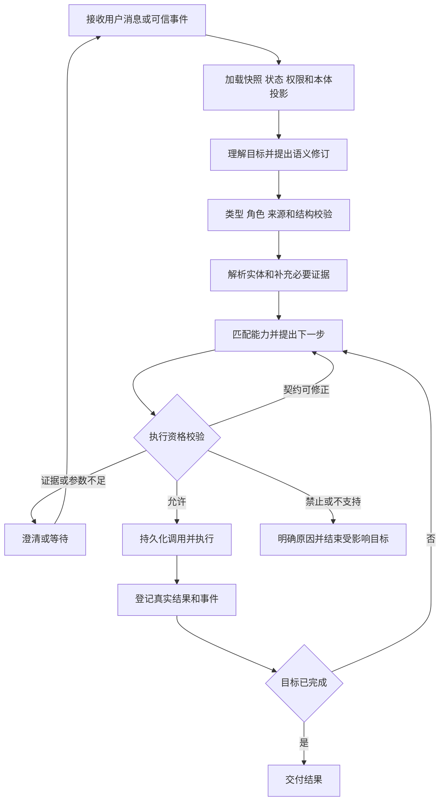

# 本体驱动意图中台总体方案

> 历史评审稿：一期设计已由[目标驱动的 V2.1 方案](./银行内网本体意图中台一期方案_V2.1.md)替代。最低 20 个真实功能、全内网、平台与智能体两套前端及正式 iframe 交付以 V2.1 为准；下文范围和排期不再作为当前承诺。

版本：V2.0｜日期：2026年9月21日｜状态：重新设计评审稿

面向产品、架构、Python 研发、业务接入、测试及运维团队。本文统一原有 Word 与 Markdown 草案，建议将中台建设为 **Python 主导的本体驱动任务平台**：用语义层描述业务世界，用动力层描述能力和状态变化，用决策层将用户目标转换为可校验、可恢复的行动。

首期采用 **FastAPI + Pydantic + LangGraph + PostgreSQL**，通过 **RDFLib + SHACL** 建立可校验的轻量业务本体。LangChain 按需提供模型和工具接口适配；Dify、HiAgent、现有 Java 服务作为下游能力接入。先把少量真实能力的识别、执行、反馈闭环做完整，再按评测结果增加向量检索、知识图谱推理和流程复用。

配套阅读：[本体与运行契约设计 V2.0](./本体与运行契约设计_V2.0.md)。该文给出本文核心对象的示例结构、状态迁移、事件协议和验收案例。

## 1 重新设计的依据和结论

### 1.1 两份草案需要统一的地方

Word 草案的产品范围较完整：Workspace、应用选择功能、发布快照、统一调用、PC 嵌入聊天、主题和卡片均应保留。但“一个意图查找一个固定 FunctionBinding”“唯一意图且达到阈值即可调用”不足以覆盖条件、多目标、历史结果续接和任务改口。

Markdown 草案已提出能力契约、Frame、dataRef、可修订语义和评测闭环，方向值得延续。其不足是本体尚未成为正式领域模型，动力和决策没有清晰契约，Python 仍处于辅助位置，发布及运行机制还不够具体。

| 设计点 | V2.0 的决定 | 直接影响 |
|---|---|---|
| 后端主技术栈 | Python 覆盖控制面与运行面 | 新平台无需同时建设 Java 和 Python 两套核心 |
| 意图表示 | 目标、对象、约束、交付物、依赖和证据 | 标签服务统计与检索，不承担全部执行语义 |
| 本体 | 显式建模对象、关系、属性、动作、条件、状态与策略 | 本体进入识别、校验、规划和结果回写 |
| 动力层 | 管理动作契约、前置条件、预期效果、状态和事件 | 有明确的“现在可做什么”和“做完如何确认” |
| 决策层 | LLM 提议，确定性规则校验，反馈驱动修订 | 既支持自然语言理解，又保留执行约束 |
| 任务状态 | 每版不可变，新增修订版本 | 保留追溯，同时支持用户更正和真实反馈 |
| 应用选功能 | 发布时确定能力范围，运行时再检查用户权限 | 检索扩展不能越过应用与用户边界 |
| 组件规模 | 模块化单体，加独立任务 Worker | 一期避免大量微服务和重复编排系统 |

### 1.2 三层是本项目的架构划分

“语义层—动力层—决策层”在本文有明确工程含义，不宣称是某个标准规定的三层名称。Palantir 对对象、关系、动作与函数的组合有成熟说明，适合作为业务建模思想参考；它是商业平台，不列为本项目的开源依赖。其官方资料强调语义对象与可执行动作相结合，本文据此形成适合本项目的三层设计。[Palantir Ontology](https://www.palantir.com/docs/foundry/ontology/overview/)

三层也不意味着每个请求要调用三次模型。简单请求可以由一次结构化模型调用提出语义与行动候选，由不同模块依次验证；复杂任务才增加按需取证和规划。

### 1.3 方案假设

沿用旧稿的行内平台场景，首批面向 PC，接入 2 至 3 个系统、20 至 30 项用户可选能力作为试点规模假设。实际容量、模型性能、人员投入、HiAgent 版本、身份系统及接口完整性尚未确认，不把这些假设写成上线承诺。

本次交付是设计文件。已核对参考项目的部分关键实现和官方资料，未运行新架构、未进行真实模型准确率测试，也没有得到新架构的性能数据。

## 2 平台定位与产品范围

### 2.1 面向使用者的完整路径

业务维护者接入 API 或工作流，业务专家确认对象与动作含义；应用创建者在 Workspace 中选择能力、配置交互和模型、运行评测并发布。最终用户通过外围系统的嵌入式聊天界面提出目标，中台理解、补充必要证据、选择能力、执行并返回结果。

| 产品模块 | 一期必须完成的内容 |
|---|---|
| Workspace 与 App | 成员、角色、应用复制、草稿、发布、停用、版本回滚 |
| 能力接入 | HTTP API、Dify/HiAgent 工作流、Skill、输入输出、证据及错误契约 |
| 本体工作台 | 类型、关系、属性、动作角色、条件、状态、能力映射和影响检查 |
| 应用配置 | 选能力、选择本体领域包、样例与反例、模型和主题配置 |
| 对话运行 | 单轮、多轮、多目标、澄清、取消、恢复、部分成功 |
| 调试与评测 | 候选、语义差异、证据绑定、拒绝原因、真实执行与模型成本 |
| 嵌入交互 | iframe、SSE、详情／列表／表单／确认／进度／下载卡片 |
| 治理运营 | 发布报告、授权、审计、模型出口、配额、下游状态监控 |

范围外：业务数据库和主数据重建、通用拖拽式流程设计器、首期全行业本体、自动训练业务推荐模型、语音坐席，以及模型任意编写脚本后直接执行业务。

### 2.2 中台编排与下游工作流的分工

中台管理**一个用户任务跨能力的依赖和进度**，例如“查客户→取拜访证据→生成准备材料”。已经封装好的授信分析、知识问答或审批流程仍由下游负责内部步骤。

旧稿“中台不负责顺序、并行和条件”的范围外表述需要收窄为“不接管下游能力内部编排”。否则无法兑现本次要求的动力层、条件任务和多目标协作。稳定组合可登记为一个复合能力，其内部流程不再由中台展开执行。

### 2.3 Function Skill Action Capability 的关系

| 名称 | 具体含义 | 示例 |
|---|---|---|
| Function | 面向应用创建者的业务功能包 | 客户拜访准备 |
| Skill | 说明能力适用情形、输入来源、输出意义与边界的版本化文档 | 如何使用拜访查询结果 |
| ActionType | 本体中的业务动作语义 | 查询拜访、生成准备材料 |
| Capability | 能实现某动作和业务结果的可执行契约 | `crm.visit.list` |
| ToolBinding | 真实 API 或工作流调用绑定 | 连接器、operation、字段映射、凭证引用 |
| IntentLabel | 运营分类或样例分组 | 拜访准备类请求 |

Function 可包含多个 Capability；ActionType 与 Capability 允许多对多；一个 Capability 可按版本、环境或数据域绑定不同接口。不能把 Skill、动作、工具和业务目标统称为“意图”后维护多套含义不同的注册表。

应用选择功能时显式展开其依赖能力。发布页展示并确认依赖范围；未选中或未获授权的依赖使该功能进入不可发布或受限状态，不在运行时自动扩展应用权限。

## 3 从智驭版借鉴的具体内容

### 3.1 核对范围

已读取用户引用的 Codex 任务“拉取 super_crm 项目”，并核对本地 `D:/pianwei/work/crm/super_crm`，当前提交为 `09a8442af`。以下结论来自本地设计文档与关键 Java 类型，不代表对全部生产分支、权限路径或部署环境做过验收。

| 智驭版实际设计或实现 | V2.0 采用方式 | 需要调整的部分 |
|---|---|---|
| `SmartSemanticOntologyProvider` 按请求投影实体、动作、关系和可见能力 | 建立统一 OntologyProjection 服务 | 权威源从 Java 枚举扩展为可发布的本体与能力包 |
| `SmartSemanticOntologyView` 包含参与者角色、结果形态和依赖 | 用类型、角色、方向、基数约束模型输出 | 不能只保留实体名称和同义词列表 |
| `SmartCapabilityContract` 约束动作、参与者、数据角色和推荐路线 | 能力匹配以契约兼容为依据 | 去掉对固定业务类型集合的全局依赖 |
| 语义快照跨车间冻结 | 每个 revision 不可变 | 错误语义通过新 revision 修订，不能原地改写 |
| 意图后水合真实历史来源和 dataRef | 模型选择来源别名，服务端绑定真实引用 | 增加时间、完整性、证据冲突和失效传播 |
| 五类动作依赖 | 沿用数据、逐项、转换、控制、回指依赖的区分 | 用户目标与技术取证步骤单独建模 |
| 统一执行生命周期 | 复用参数、权限、调用、结果、事件的职责划分 | 用 Python 重新实现中台边界，业务能力通过 API 复用 |

智驭版的语义本体由已有注册事实编译，不是“另建一份知识图谱再让两边手工同步”。这点应保留：本项目也只设一份版本化语义权威源，其余模型短卡、检索索引、运行校验表由发布编译器生成。

### 3.2 不能照搬的业务限制

参考项目当前围绕 `customer / product / user / org` 四类正式实体建设，拜访记录等通过关系资源建模。中台面向多个系统，应允许独立领域包增加工单、合同等类型，也允许带时间、状态、金额的业务事件成为一等对象；具体采用对象还是关系资源由业务契约决定。

参考项目功能矩阵记载 14 项正式能力，并明确没有通用的直接写库工具。V2.0 中“创建拜访计划”的示例是**新平台未来接入能力的设计样例**，不能宣称智驭版已支持。`launchFeature` 打开页面的成功不等于业务记录创建成功。

参考项目的 `LIST / ATTRIBUTE / QA / ANALYZE / RECOMMEND / GUIDE` 可作为基础动作词汇，但不要求所有未来能力都先改动同一个枚举。新业务动作以命名空间 ID 注册，通用动作家族用于检索和统计。

已有 128 条单轮、20 个多轮场景共 43 轮的评测资产可作种子。迁移时重新确认语义金标、真实数据前提和允许执行路径，尤其不能把旧项目专属的工具路径当作中台唯一正确答案。

## 4 总体架构

语义层、动力层、决策层是领域职责；控制面、运行面是部署与发布边界；执行网关是统一的副作用入口。三种划分不要混成一棵服务目录。

### 4.1 控制面

维护 Workspace/App、本体定义、能力包、连接器、模型配置、评测集、主题和版本。发布前将本体、动作约束、Skill、Schema、依赖和索引编译成一致快照。业务人员使用表单编辑，不要求手写 RDF。

### 4.2 运行面

加载已发布快照和会话状态，获得请求级本体投影，生成结构化语义及行动候选；校验后由网关调用；真实结果推动状态迁移和后续决定。运行面不能直接读取正在编辑的草稿。

### 4.3 部署形态

一期一个 Python 代码库，两个进程角色：`api` 处理鉴权、对话接入、SSE 和管理接口；`worker` 推进可恢复任务、长调用、回调处理及离线评测。二者共享领域模块，分别扩容。PostgreSQL 为权威存储，文件及大结果放行内对象存储。

任务队列首期可用 PostgreSQL 任务表、租约和 outbox 实现；Redis 仅在行内已有服务时用于缓存、限流或通知。队列通知丢失后 Worker 仍可扫描数据库恢复任务。Kafka、独立图数据库、独立向量库和跨集群流程引擎均不作为一期必需依赖。

## 5 语义层 让业务概念成为可计算契约

### 5.1 建模范围

本体首先描述业务语义及约束，不复制整个 CRM 数据库。具体业务事实仍由原系统负责，中台保存满足当前任务的事实快照和来源。

| 本体对象 | 必须表达的内容 | 例子 |
|---|---|---|
| ObjectType | 稳定 ID、业务定义、身份规则、父类和属性 | 客户、产品、拜访记录 |
| PropertyType | 类型、单位、时间口径、缺失含义 | 存款余额、拜访时间 |
| RelationType | 起点、终点、方向、基数、有效时间 | 客户经理管理客户 |
| ActionType | 目标语义、角色和交付物 | 向某客户推荐产品 |
| EvidenceType | 数据或知识来源、适用范围、完整性 | 客户快照、制度片段 |
| Constraint | 类型、角色、范围或业务条件 | 推荐接收方为客户，候选为产品集合 |
| Goal | 用户期望达到的状态或取得的结果 | 得到明天拜访客户的准备材料 |

“客户经理”“管理客户”“近三个月”“推荐五家”不能全部塞进同一个 intent_id。它们分别对应身份或角色、关系、时间约束、数量与交付物。

### 5.2 定义 实例和事实分开

类型定义属于发布本体，例如 `bank:Customer`；具体客户属于业务实例，以“来源系统＋实体类型＋业务主键”定位。名称只能作为待解析提及，不能自动获得正式 ID。

事实记录值、来源、观察时间、业务有效时间、可信等级和证据引用。用户说“这是我的客户”属于用户声明；业务接口返回的管户关系属于带时间的业务事实；模型推测二者均不能覆盖。

会话意图快照、本体定义和业务事实具有不同生命周期。修改能力描述无需改写历史业务事实；用户改口无需修改本体；收到新业务事件也不等于用户改变目标。

### 5.3 本体的技术表达

采用有限、可解释的本体子集：稳定概念 ID、类型与继承、关系的域和值域、角色、基数、枚举和单位。管理端形成规范化 JSON/YAML 包；发布时生成 RDF 图及 SHACL Shapes，同时生成运行期 Pydantic/索引所需元数据。

RDFLib 用于 RDF 解析、序列化和查询；pySHACL 用于图与 Shapes 的校验。它们承担语义基础设施，不替代业务状态机或任务执行器。[RDFLib](https://github.com/RDFLib/rdflib)、[pySHACL](https://github.com/RDFLib/pySHACL)

SHACL 主要验证发布包及测试事实图的形状；热路径的角色、类型、参数和来源检查用同一发布包编译出的校验器执行。需要 SHACL 的复杂验证可放发布阶段或按需后台运行，不要求每次请求扫描全库。SHACL 是验证语言，不能把“验证通过”解释为业务事实真实、接口调用成功或用户已授权。[W3C SHACL](https://www.w3.org/TR/shacl/)

一期不引入无约束 OWL 全量推理。允许的类型继承、逆关系和受控派生规则形成明确清单，每条派生事实保留规则版本和输入证据。没有记录不自动证明事实为假：例如“没查到拜访”只有在时间窗口和覆盖范围完整时才可证明“该窗口没有拜访”。

### 5.4 本体如何真正参与识别

1. 用应用能力清单和当前用户可见范围构建本体投影。
2. 加入当前请求涉及的类型、关系、动作角色、结果类型、上下文来源摘要。
3. LLM 把自然语言映射成目标、对象提及、约束和语义关系。
4. 校验概念是否存在、角色类型是否相容、关系方向是否正确、时间和数量约束是否保留。
5. 对实体歧义、缺证据和能力缺口分别处理；必要时扩展当前应用内的投影并重试。

一个典型校验是“给产品 A 找潜在客户”：推荐目标角色为产品，候选为客户。若某能力只支持“给客户推荐产品”，即使名字相似，也不能通过调换参数冒充支持反向推荐。

本体投影缩小模型搜索空间，但不能代替真实语言理解。词汇别名用于候选召回；不能将“出现推荐一词”写成忽略否定和上下文的执行规则。

### 5.5 本体治理

平台维护通用元模型，领域负责人维护领域包，能力负责人维护动作到接口的绑定，应用创建者维护应用选择和局部词汇。局部扩展不得悄悄改变公共概念原义；语义变化创建新版本或新 ID，并登记替代关系。

发布前检查重复概念、悬空引用、错误关系方向、角色不匹配、失效能力和破坏性修改。模型可生成草稿和映射建议，不能直接发布新概念或把工具输出中的新词自动提升为全局本体。

## 6 动力层 定义动作如何改变任务和业务状态

### 6.1 动力层的职责

动力层回答四个问题：某动作现在是否可执行，需要什么证据，执行会产生什么效果，发生事件后状态如何变化。它连接静态本体和实际系统行为，包含只读查询、派生计算、文档生成、页面导航及有业务副作用的动作。

每个动作绑定的能力必须声明输入／输出类型、前置条件、预期效果、成功判定、错误分类、超时、幂等、状态查询、取消能力和必要的补偿方式。预期效果是“成功后应成立”的条件，不是模型可写入事实库的承诺。

### 6.2 三类状态不能混用

| 状态 | 权威来源 | 如何变化 |
|---|---|---|
| 业务对象状态 | 原业务系统 | 接口响应、经验证的回调或再次查询 |
| 任务状态 | 中台事件账本 | 用户目标、计划、等待、完成及取消事件 |
| 语义假设状态 | 版本化意图记录 | 用户更正、实体解析、证据或契约反馈 |

例如“创建拜访计划”：模型提议动作后，任务进入待校验；网关提交后，调用进入执行中；只有下游返回可验证的业务记录或状态查询确认成功，才记录“计划已创建”。页面已打开、请求已接收和业务已完成是不同事件。

### 6.3 条件与效果

条件采用受控表达式树，只允许注册属性、比较、逻辑与受控关系查询；不接受任意 Python、SQL 或由模型生成的执行脚本。

条件求值至少使用 `TRUE / FALSE / UNKNOWN` 三种结果。证据冲突单独返回冲突原因；不能把 UNKNOWN 当 FALSE。例如“近三个月未拜访”需要完整的拜访覆盖证据；“客户活跃”需要业务系统状态；“当前用户有权限”由授权服务判断。缺证据时先尝试允许的必要查询，仍无法确定再澄清或阻塞。

查询动作的效果可以是产生某类证据，生成动作的效果可以是产生文档，写动作的效果才可能是业务对象变化。不得把所有工具都描述为更新业务图谱。

### 6.4 事件与事实反馈

用户更正、工具完成、工具失败、业务状态变化、权限撤销和等待超时均进入事件处理。一次事件具有唯一 ID、来源、任务范围和发生时间。事件先验证来源与重复，再更新对应事实和任务状态。

派生事实和未执行步骤登记其依赖的证据版本。客户改选、余额更新或来源撤销后，相关派生结果标记失效；已完成调用保留历史，未执行的依赖重新校验。

中台不承担无条件的跨系统事务：已有调用不能因用户说“取消”就假装回滚。对不可撤销动作说明实际状态；可补偿动作通过独立的、已登记且满足授权的补偿能力执行。

## 7 决策层 从目标到下一项可执行行动

### 7.1 核心分工

LLM 擅长目标理解、语义映射、候选计划和澄清措辞。确定性代码负责作用域、Schema、类型、条件、授权、版本和预算检查。业务推荐、授信等专业算法仍调用登记能力，不能因通用模型能够生成文字就宣称具有该业务决策能力。

决策输出是一组用户目标、结构化语义和当前下一步，而非强制一个标签。多个目标不等于歧义；只有同一个目标存在不能同时成立的解释或参数选项时才需要消歧。

### 7.2 请求处理闭环

上述是逻辑步骤，不要求每一块调用模型。实体解析、角色校验、条件求值、API 参数映射和结果登记优先使用代码或已注册业务服务。

### 7.3 计划构造方式

从目标需要的交付物反查可以产生该结果的能力，再检查它的输入类型、前置条件和当前证据。缺少的可获取证据成为前置步骤；存在真实歧义才产生 Question。

一期采用有限深度的类型兼容检索与 LLM 候选计划，输出 DAG。数据依赖、用户要求的先后、逐项处理和结果转换分别表示。逐项处理必须限制数量并优先调用批量接口，不能无界展开客户集合。

确定性校验检查环路、引用、状态条件、越权、重复副作用、结果完整性与预算。软偏好仅在合法计划中比较，例如更少调用、更低延迟或用户偏好的结果形态；低成本不能抵消授权或业务前置条件失败。

当存在多条结果等价且合法的路径时，可依据发布策略选择，无需都问用户。不同路径会产生业务含义、数据范围或实际成本差异时，保留差异并请求必要选择。

### 7.4 简单请求与复杂请求

简单请求一次模型输出 `SemanticProposal` 和可选 `NextActionProposal`，分别校验并按已有绑定编译。实体未闭合时，先解析再使用候选行动；不能为了保持“一次调用”而猜业务 ID。

复杂请求允许多目标和取证循环，但不每轮重新生成全部历史计划。每次只对未完成部分提交 patch，记录 `base_revision`。重复失败且状态无进展时终止修复循环，返回具体能力或证据缺口。

### 7.5 LangGraph 的使用方式

LangGraph 负责显式节点、条件边、持久化检查点和等待外部输入；业务语义、能力契约、策略和事件账本由本项目定义。使用开源库自托管不要求使用托管服务；框架的状态保存也不自动提供业务幂等与跨租户授权。[LangGraph](https://github.com/langchain-ai/langgraph)、[持久化](https://docs.langchain.com/oss/python/langgraph/persistence)

建议节点为 `load_context / understand / validate / resolve / plan / gate / invoke / observe / respond`，只在必要节点调用模型。长任务或用户补参保存检查点并释放 Worker；下一事件从持久化状态恢复。

LangGraph 的 interrupt 恢复可能重新执行中断节点前面的代码。因此询问节点与业务写节点必须分离；工具副作用统一经调用账本去重，恢复时重新校验版本和权限。用框架检查点实现恢复，不把它解释为外部业务系统的“恰好一次执行”。[Interrupts](https://docs.langchain.com/oss/python/langgraph/interrupts)

## 8 能力发现和模型接入

### 8.1 三种范围明确区分

`RegisteredCapabilities` 是平台登记的能力；`AppSnapshotCapabilities` 是应用发布选择的能力；`RequestVisibleCapabilities` 是本次请求可见的子集。本轮检索候选属于第三者的暂定集合。

应用选功能决定业务范围，用户授权决定可见和可执行范围。执行前仍复查最新授权及对象级权限，避免管理员选中了能力就让所有应用用户获得相同数据权限。动态撤权优先于旧快照。

### 8.2 先建立全量短卡基线

20 至 30 项能力时，先将当前可见能力的短语义卡和必要本体片段提供给模型，完整 Skill/Schema 按需加载。测得上下文、成本或注意力问题后，再引入词项与向量混合召回、本体邻接扩展和重排。

向量召回只解决“哪些能力值得先看”，不证明最终意图正确。发现结果不足时允许在当前可见集合内扩展；语义类型尚未确定时保留其他候选，不按第一次猜测硬过滤。不能声称分批分类或 Top-K 天然无损。

pgvector 适合与现有 PostgreSQL 共库起步，但近似索引和过滤组合可能降低召回。需对应用／租户过滤后的候选数、漏召回和跨域混淆单独评测；小集合优先精确检索。[pgvector](https://github.com/pgvector/pgvector)

### 8.3 模型适配

业务层依赖统一 `ModelPort`，支持结构化响应、超时、流式、usage 和错误分类。LangChain 只封装模型差异和按需集成，不能作为领域对象存储，也不暴露任意工具执行入口。

按实际模型测试原生结构化输出、工具参数输出和 JSON 文本解析三种路径。JSON Schema 通过不等于语义或权限通过；禁止缺字段后静默填成能执行的默认参数。供应商结构化输出能力存在差异，应在模型配置中保存实测兼容矩阵。[LangChain structured output](https://docs.langchain.com/oss/python/langchain/structured-output)

一期一个主模型加一个通过同一评测的备用模型；参数错误可有限修复，限流或服务错误走技术重试。备用模型和外网出口的选择必须符合当前数据等级，不能把内网模型失败自动转成外网调用。

## 9 Python 技术栈与开源采纳边界

### 9.1 推荐基线

| 模块 | 首期技术 | 为什么采用 | 本项目仍需实现 |
|---|---|---|---|
| API 和事件出口 | FastAPI、ASGI、HTTPX | Python API 与异步 I/O 统一 | 鉴权、SSE 重连、连接器规范 |
| 数据结构 | Pydantic、JSON Schema | 强类型边界和结构校验 | 语义、权限、来源、状态校验 |
| 任务运行 | LangGraph 与 PostgreSQL checkpointer | 显式状态图、恢复与等待 | 调用账本、事件串行化、版本迁移 |
| 模型接口 | ModelPort，按需用 langchain-core／provider 包 | 更换模型不改变领域对象 | 兼容矩阵、出口策略、预算 |
| 本体编译 | RDFLib、pySHACL | 采用成熟 RDF 与约束工具 | 元模型、动作 DSL、发布编译器 |
| 持久化 | PostgreSQL、SQLAlchemy、Alembic | 统一业务记录、事件和版本事务 | 隔离策略、迁移、保留与恢复 |
| 候选发现 | 先全量短卡，随后可加 pgvector | 便于建立效果基线 | 召回融合、作用域和回退机制 |
| 观测评测 | OpenTelemetry、结构化日志；按需 Langfuse | 关联模型与真实执行 | 业务金标、切片评分、脱敏 |
| 前端 | React、TypeScript、assistant-ui 适配 | 复用聊天交互组件 | 本体工作台、业务卡片、主题和 iframe |
| 工程质量 | uv、Ruff、类型检查、pytest | 依赖锁定、类型和回归约束 | 项目测试集与发布门禁 |

FastAPI、Pydantic 提供框架和模型验证能力，本项目的权限和领域校验不能由框架默认替代。[FastAPI](https://github.com/fastapi/fastapi)、[Pydantic Models](https://docs.pydantic.dev/latest/concepts/models/)

Python 建议从 3.12 或 3.13 中选一个完成依赖兼容验证的版本作为首期基线，不追逐最新小版本；最终写入锁文件和部署镜像。开发使用 Windows 或 Linux，生产优先沿用行内 Linux 容器平台。

### 9.2 值得借鉴但不整套引入的项目

| 项目 | 核对到的能力 | 本方案位置与决定 |
|---|---|---|
| OpenSPG / KAG | 领域 Schema 约束、知识与文本关联、逻辑形式引导推理 | 本体和证据推理的重要参考；复杂知识问答阶段做独立 PoC |
| Microsoft GraphRAG | 从文档构建图索引并支持基于图的 RAG | 面向非结构化知识探索的备选证据能力 |
| Dify | 应用管理及下游工作流生态 | 参考管理体验，通过接口接入既有应用 |
| assistant-ui | React 聊天交互库 | 前端基座候选，用自定义 Runtime 对接 |
| AG-UI | Agent 与前端的事件协议 | 映射常用运行、文本和工具事件，不暴露框架内部状态 |
| Langfuse | 模型调用追踪、评测与提示管理 | 可选自托管观测平台，审计仍落中台账本 |

KAG 的 Schema 约束知识构建和逻辑形式值得借鉴；是否引入 OpenSPG 引擎，要比较部署成本、数据映射维护、问答质量和可追溯性。其事实问答能力不能直接替代用户授权、业务动作生命周期和多轮任务状态。[KAG](https://github.com/OpenSPG/KAG)、[OpenSPG](https://github.com/OpenSPG/openspg)

GraphRAG 是图增强检索方案。把文档抽成图不等于已有可执行业务本体，更不意味着可据抽取结果直接写 CRM；它适合作为某类知识证据能力，通过统一契约进入中台。[Microsoft GraphRAG](https://github.com/microsoft/graphrag)

assistant-ui 与 AG-UI 的采纳以本地自托管和协议适配验证为准，保留现有自定义卡片契约；不将业务状态与某个前端组件内部状态绑定。[assistant-ui](https://github.com/assistant-ui/assistant-ui)、[AG-UI](https://github.com/ag-ui-protocol/ag-ui)

### 9.3 许可和运维选择

截至本次核对，LangGraph 为 MIT，RDFLib 为 BSD-3-Clause，pySHACL 与 OpenSPG/KAG 为 Apache-2.0。依赖清单应固定到实际使用的版本、许可证及依赖项；不把仓库标题中的“开源”当作所有模块许可相同。[LangGraph LICENSE](https://github.com/langchain-ai/langgraph/blob/main/LICENSE)、[RDFLib](https://github.com/RDFLib/rdflib)、[pySHACL LICENSE](https://github.com/RDFLib/pySHACL/blob/master/LICENSE.txt)

Dify 当前许可证含多租户及前端标识附加条件，因此本方案选择接入已授权下游 API、自建中台控制面，不以直接 fork Dify 后改成多 Workspace 平台作为默认路径。具体采用源码的范围按目标版本条款确认。[Dify LICENSE](https://github.com/langgenius/dify/blob/main/LICENSE)

Langfuse 仓库对 `ee` 目录另有许可边界；一期可只保留 OpenTelemetry 和应用日志，确有追踪分析需要再部署其适用版本，避免为了观测增加超出团队运维能力的组件。[Langfuse](https://github.com/langfuse/langfuse)

## 10 运行可靠性和证据管理

### 10.1 任务修订和并发

同一任务的用户事件和工具回调由单个有效 Worker 租约推进，并使用数据库 revision 比较更新防止旧结果覆盖新状态。租约超时后接管必须带 fencing token；旧 Worker 即使仍运行也不能提交新状态或新调用。

语义 revision 与 plan revision 分开。新用户指令先判断续答、修订、取消或新目标，再更新未执行步骤。多个会话不能因为使用同一个浏览器或同一客户名称而共享任务状态。

LangGraph 检查点是运行恢复结构；中台 task/event/call 表是业务权威记录。检查点落后时从已提交事件重放，不能凭检查点中有“即将执行”就重复调用外部写接口。

### 10.2 调用账本与幂等

执行前在事务内登记稳定 `call_id`、绑定版本、参数、业务幂等键、任务 revision 和 outbox。Worker 投递后保存下游 operation_id、最终状态和结果引用。同一语义动作的重试沿用原 call，不因重新规划产生一个新写请求。

外部调用与数据库提交不共享事务，必须承认“下游成功而本地未记账”的窗口。下游提供幂等键和状态查询时据此恢复；没有这两项能力的写接口，响应不明后进入 `EXECUTION_UNKNOWN` 并停止自动重放。方案追求可恢复和有效去重，不承诺跨系统天然恰好一次。

### 10.3 dataRef 和知识证据

真实结果引用只由执行网关登记，包括来源、类型、主体、时间、完整性、数据范围、版本和血缘。模型可以看到有限来源别名和摘要，真实引用读取由服务端验证当前访问权限。

知识证据增加文档版本、生效期间、来源级别和引用位置；业务数据增加查询窗口、集合覆盖、分页和单位。二者可共同参与分析，但模型不能把一段历史回复当成当前余额或有效制度证据。

“导出刚才列表”复用当时快照；“查现在的列表”重新获取当前事实。“第一页 20 条”不能用作“总客户数”的完整数据；聚合优先下推真实业务服务，或者按明确的全量遍历契约执行。

### 10.4 降级规则

| 故障或限制 | 对外行为 |
|---|---|
| 模型不可用 | 返回可重试状态；已完成结果仍可查看，标准卡片不依赖新模型调用 |
| 能力索引不可用 | 在上下文允许时回退全量可见短卡；否则说明发现服务暂不可用 |
| 某个独立目标失败 | 交付其余已完成目标，逐项目标给出状态 |
| 前置证据失败 | 阻塞依赖该证据的步骤，不让模型补造事实 |
| 业务拒绝或无权限 | 说明受影响目标与原因，不换接口绕过 |
| 用户取消后收到成功回调 | 保存实际执行事实，不继续旧计划；必要时告知已发生结果 |
| SSE 断开 | 任务独立运行；重连按事件序号恢复，不重提整个任务 |

## 11 发布 隔离与安全边界

### 11.1 发布一致性

一个发布快照固定应用能力清单、本体版本、动作与策略版本、ToolBinding、输入输出 Schema、Skill、提示、模型配置、索引版本和主题。构建和测试完成前不移动活动版本指针。

发布顺序为“冻结待发布清单→编译和校验→构建索引→契约与评测→标记 ready→事务切换应用指针”。失败保留上一版本。检索索引不与数据库强行双写同一事务，而是先构建版本化索引，再由快照引用 ready 版本。

会话创建时固定快照；未显式迁移的在途任务继续使用原版本。停用能力和权限撤销通过独立实时策略生效；快照固定不能保留已撤销权限。快照回滚只影响新任务，不回滚已经发生的业务操作。

### 11.2 隔离和身份

身份由 SSO／网关凭据恢复，客户端传来的 `user_id / workspace_id / roles` 不作为授权事实。每次读取任务、证据、下载文件和恢复 SSE 都验证资源归属；不能只保护首次聊天接口。

PostgreSQL 表按 Workspace/App 等作用域设计，可叠加 RLS。应用连接使用受限数据库角色；表所有者、超级用户或具备绕过 RLS 权限的角色不作为运行账号，避免把 RLS 配置误当作完整隔离。[PostgreSQL RLS](https://www.postgresql.org/docs/current/ddl-rowsecurity.html)

Skill、知识文档和工具返回值属于有来源的数据，不能自行修改权限、连接器地址或执行规则。模型只提交注册 ID 和业务参数，不能指定任意 URL、SQL 或凭证。连接器维护地址白名单、TLS 和出网约束。

### 11.3 嵌入和消息协议

外围系统后端兑换短期、一次性 iframe Ticket，绑定用户、应用和允许 Origin；iframe 使用受控 postMessage 来源校验及 CSP。模型和下游只能返回注册组件类型、版本与 props，不能输出任意 HTML/JavaScript 作为可执行界面。

统一事件至少包括接受、状态变化、文本、结果卡片、澄清、确认、完成及失败；每个事件有单调序号和 task/frame/call 关联。AG-UI 是可选对外映射，内部业务协议独立版本化。

## 12 数据模型和接口设计范围

核心表分为四组：配置与发布、本体与能力、任务与调用、证据与评测。首期优先关系表保存索引、归属和唯一约束，JSONB 保存版本化的复杂语义结构；不把全部状态塞进单一 session JSON。

| 对象组 | 主要记录 |
|---|---|
| 配置与发布 | workspace、application、membership、release_manifest、active_release |
| 本体与能力 | ontology_package、concept_definition、capability_version、tool_binding、app_capability |
| 任务与调用 | conversation、task、goal、semantic_revision、plan_revision、task_event、tool_call、outbox、question |
| 证据与质量 | evidence、evidence_dependency、confirmation、evaluation_case、evaluation_run、decision_trace |

管理面提供能力、本体、校验、评测和发布接口；运行面提供消息、任务查询、事件流、交互动作和签名回调。识别调试接口只生成提议，不可隐式触发业务副作用。详细字段与例子见配套契约文档。

## 13 评测和验收

### 13.1 用消融实验验证本体的贡献

| 对照版本 | 控制变量 | 要回答的问题 |
|---|---|---|
| B0 全量能力短卡和结构化输出 | 固定模型、样本和能力 | 基础 LLM 路由能做到什么 |
| B1 增加语义本体和校验 | 其他同 B0 | 对象、关系、角色和复杂条件是否更准确 |
| B2 增加动力层和版本化反馈 | 其他同 B1 | 多轮改口、条件任务和错误恢复是否改善 |
| B3 增加检索／复合能力 | 其他同 B2 | 成本与延迟下降是否伴随召回或成功率损失 |

本体效果必须与不含本体的同模型基线比较，不能仅展示几个成功案例。若简单请求明显变慢，优先缩短投影、合并模型调用或下沉确定性步骤，再评估复杂推理组件。

### 13.2 数据集与评分

使用参考项目评测资产加首批业务真实脱敏样本，建立单轮、多目标、多轮、条件、权限、数据完整性、故障恢复七类切片。数据按会话和表达族划分开发、校准和封存测试集，防止同一模板换客户名进入不同分区。

金标包括应保留的目标、关系方向、对象角色、约束、需要的证据和合法交付；允许多个等价计划。对已明确业务语义的否定、纠正与时间变化设计成对测试，检查应变化和应保持的内容。

主要指标：目标与约束完整率、实体／关系／角色正确率、必需能力覆盖率、端到端任务完成率、多目标全部完成率、错误调用率、不必要澄清率、恢复成功率、数据引用错绑率、模型调用数、Token、单任务成本和 P50/P95 延迟。

模型自报 confidence 不作为正确率，不以单一阈值直接放行所有业务动作。若未来引入置信阈值，需在独立校准集测量错误率与自动处理覆盖率。

### 13.3 首期验收建议

以下是待基线验证后确认的目标，不是已达成指标：

| 项目 | 建议试点门槛或确认方式 |
|---|---|
| 语义与任务效果 | 封存集中简单任务完成率目标不低于 95%，复合及多轮目标不低于 85%；按切片报告样本量和区间 |
| 本体有效性 | B1/B2 对目标难点有收益，常规请求无超过 2 个百分点的明显退化；结果不足时扩大样本核验 |
| 错误执行 | 验收集中未授权调用、错对象写入、取消后新发写入、重复写入必须为 0；不能据此宣称生产风险为零 |
| 模型效率 | 简单请求通常一次理解调用；额外调用均可解释为取证、歧义或错误恢复 |
| 延迟 | 一期建议普通单轮识别 P95 ≤ 3 秒作为测量目标，须注明模型、输入长度和并发；下游及生成时间另计 |
| 运行可靠性 | 重复回调、Worker 重启、断流恢复、超时不明、权限撤销均通过确定性场景验证 |
| 发布治理 | 能力／本体破坏性变更阻断发布，快照切换和回滚可复现，在途任务行为明确 |

容量测试须先确认峰值到达率、活动长任务数、SSE 连接数、模型配额和接口限流。用“到达率 × 平均占用时长”估算并发，再以压测修正；外部 LLM 和下游往往决定瓶颈，不能只按 API 进程数承诺 QPS。

### 13.4 测试范围

遵循“小功能小测试，大版本全量测试”。单能力描述或映射改动测该能力、相邻混淆项与直接依赖；单本体类型改动沿依赖图测受影响能力与场景。模型、全局提示、元模型、任务状态协议、通用策略或大版本变更做全量回归，并覆盖隔离、恢复、兼容、性能及回滚。

本次仅进行文档、引用和示例结构检查，不代替上述产品验收。

## 14 分阶段实施和工作量假设

建议试点团队为 1 名技术负责人、2 名 Python 工程师、1 名前端工程师、1 名测试工程师，另需业务专家和运维兼职参与。以下是依赖真实接口按时可用的规划估算，应在阶段 A 结束后重新排期。

| 阶段 | 预计时间 | 主要交付 | 退出条件 |
|---|---|---|---|
| A 业务契约和基线 | 1 至 2 周 | 6 至 8 项代表能力、领域词汇、金标、模型基线 | 概念、权限、接口和成功标准明确 |
| B 最小纵向闭环 | 2 至 3 周 | App 发布、轻量本体、单轮识别、网关、证据、聊天 | 查询／知识／导出等真实链路可运行 |
| C 多轮和动力机制 | 2 至 3 周 | 目标修订、条件、Question、状态恢复、幂等 | 多轮与故障场景通过验收 |
| D 治理与试点 | 2 至 3 周 | 本体工作台、回放、灰度、主题、模型备援 | 全量回归及试点门槛通过 |

总体约 7 至 11 周是规划窗口，不是固定承诺。模型准入、业务 API 缺失、跨系统身份映射和下游工作流改造需单独计入依赖计划。

首批推荐能力覆盖实体解析、事实查询、列表、知识问答、分析或推荐、文件导出；写入能力只选一个具备幂等和状态查询契约的低复杂度场景试点。不要一开始把多个领域、全部智驭版功能和复杂图谱平台一起迁移。

灰度先影子比较语义和计划，不额外执行真实写入；再开放少量用户的只读任务，最后开放满足条件的副作用能力。若在现有智驭版旁路试点，适配器消费其现有业务接口，Python 中台与原 Java 运行时不能同时执行同一用户任务。

## 15 关键决策记录和待落实事项

| 决策 | 采纳理由 | 重新评估触发条件 |
|---|---|---|
| Python 主后端 | 统一模型开发、运行、契约和评测 | 行内基础能力必须通过既有 Java 网关时增加适配，不改核心语言 |
| LangGraph 显式编排 | 满足有状态任务与恢复，便于观察每步 | 长时跨系统事务需求超出现有机制时评估专用流程运行时 |
| 轻量 RDF/SHACL 本体 | 可验证、可版本化，起步成本可控 | 跨域图查询和推理需求成为主要瓶颈时评估 OpenSPG |
| PostgreSQL 作为权威源 | 简化一致性和运维 | 证据量或向量检索吞吐达到实测瓶颈时拆分 |
| 受控语义修订 | 能恢复误判并保留审计 | 若引入反复改计划，用评测约束进展和修订预算 |
| 自建控制面，复用开源基础件 | 本体与动作治理是核心差异 | 同类组件出现且经过契约、许可和迁移验证后替换 |

进入实现前需落实：首批能力和真实 Skill、对象主键与跨系统身份规则、业务前置条件及证据完整性、应用与数据授权模型、HiAgent 认证／回调／取消机制、内外网模型可用范围、峰值负载和可接受错误代价。

这些事项不阻止本版方案评审，但对应能力在缺少真实契约时不能被标记为“已接入”。

## 16 参考来源与可追溯性

### 16.1 本地材料

原始需求：[Word 草案](./行内意图中台需求与总体方案_V1.0.docx)、[识别与路由草案](./意图中台识别与能力路由建设方案_v1.0.md)。

用户引用任务：[拉取 super_crm 项目](thread://01a05aa7-4060-7933-ab20-a544d243b26d?hostId=local)。本地源码核对日期为 2026年9月21日，提交 `09a8442af`。

| 依据 | 关键用途 |
|---|---|
| [意图车间设计](D:/pianwei/work/crm/super_crm/doc/design/smart/智驭版意图车间设计文档.md) | 结构化语义、Frame、模型输入与冻结边界 |
| [总体架构设计](D:/pianwei/work/crm/super_crm/doc/design/smart/智驭版总体架构设计文档.md) | 车间分工、上下文、dataRef、执行和表达 |
| [实体关系动作属性清单](D:/pianwei/work/crm/super_crm/doc/guide/智驭版实体关系动作属性清单.md) | 正式实体、关系资源和依赖角色 |
| [工具清单](D:/pianwei/work/crm/super_crm/doc/guide/智驭版工具清单.md) | 能力 ID、真实工具及业务边界 |
| [语义本体投影实现](D:/pianwei/work/crm/super_crm/src/backend/src/main/java/com/crm/smart/domain/ontology/SmartSemanticOntologyProvider.java) | 注册事实到请求级投影 |
| [本体视图](D:/pianwei/work/crm/super_crm/src/backend/src/main/java/com/crm/smart/domain/ontology/SmartSemanticOntologyView.java) | 角色、类型、关系和结果契约结构 |
| [能力契约](D:/pianwei/work/crm/super_crm/src/backend/src/main/java/com/crm/smart/domain/capability/SmartCapabilityContract.java) | 类型与参与者兼容 |
| [依赖协议](D:/pianwei/work/crm/super_crm/src/backend/src/main/java/com/crm/smart/contract/intent/SmartIntentDependencyProtocol.java) | 五类正式依赖 |
| [决策快照](D:/pianwei/work/crm/super_crm/src/backend/src/main/java/com/crm/smart/contract/intent/SmartIntentDecisionSnapshot.java) | 冻结语义的现有机制 |
| [执行生命周期](D:/pianwei/work/crm/super_crm/src/backend/src/main/java/com/crm/smart/workshop/execution/coordinator/SmartToolExecutionLifecycleCoordinator.java) | 统一执行入口 |
| [评测覆盖矩阵](D:/pianwei/work/crm/super_crm/智驭版意图路由评测集/功能与覆盖矩阵.md) | 能力边界及测试资产 |

参考文档存在不同时间的协议版本描述，因此本文以已读取的代码类型与字段说明具体机制，不将文档中所有“已落地”表述视为本次验证结论。

### 16.2 外部资料的使用范围

正文已就近给出官方仓库、标准和文档链接，核对日期同上。开源项目能力来自官方描述；三层组合、存储设计、阈值建议、实施顺序及成本取舍是本项目的设计判断。没有把开源项目的宣传指标或客户案例准确率作为本中台的验收成绩。
