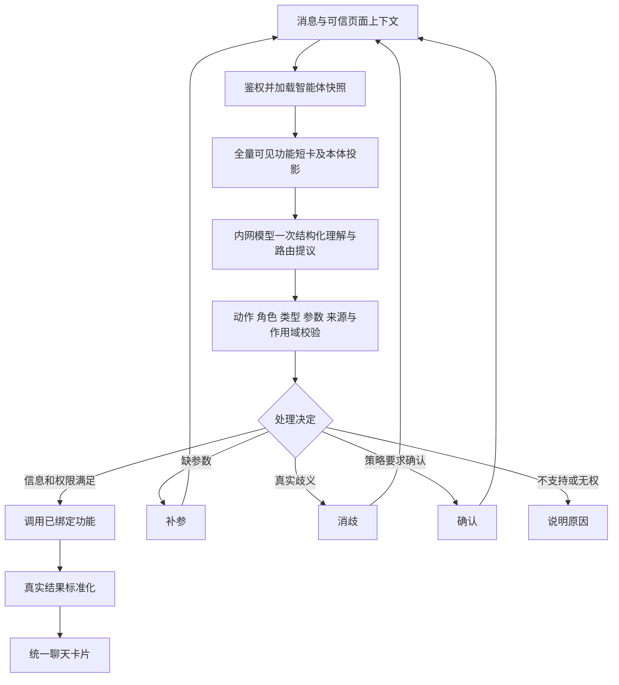
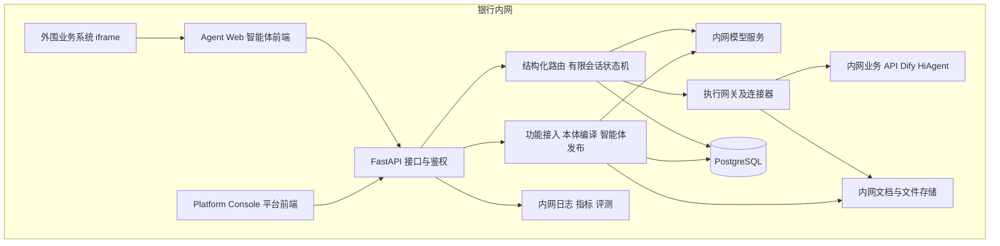

# 银行内网本体意图中台一期方案

版本：V2.1｜日期：2026年9月21日｜状态：按明确需求优化的评审稿

本版以三个交付目标组织设计：**企业级本体意图中台、用户在隔离空间自助接入至少 20 个功能并组合场景智能体、每个智能体具有统一且可 iframe 嵌入的运行前端**。平台前端负责管理与发布，智能体前端负责终端用户的业务交互，两者是不同交付物。模型推理、文档处理、路由、业务调用、存储、评测与日志全部在银行内网运行，这是已确认的部署约束。

可行性结论：上述目标可以通过现有 Python 技术和内网模型实现。主要研发内容是能力接入、本体映射、智能体发布、路由校验及统一交互；识别质量和延迟须通过 20 个真实功能的封存评测证明。完整的自主任务规划、全行实例图谱和通用工作流引擎不构成一期前提。

本版替代 V2.0 的一期定位、运行主链、范围与验收口径。配套协议以[功能接入与智能体路由契约 V2.1](./功能接入与智能体路由契约_V2.1.md)为准。文中的指标是建议验收目标，尚无实现或实测成绩。

## 1 从需求确定交付和可行性

| 需求 | 一期必须交付 | 可行性与实现条件 | 验收方式 |
|---|---|---|---|
| 企业级本体识别，适配银行不同场景 | 共用元模型、可扩展领域包、空间隔离、权限、版本、审计、运行观测 | 工程可实现；业务定义需有明确来源，新增领域不能依赖改写路由核心 | 用不同业务对象和场景智能体验证同一内核，新增领域以配置接入 |
| 用户自定义加入功能接口和说明文档 | 接入向导、文档解析、本体映射草稿、差异确认、接口测试、功能发布 | 工程可实现；API 结构和业务说明不足时，平台指出缺项，用户在表单补齐 | 用户经界面完成接入，不修改后台代码和全局 Prompt |
| 选功能打包智能体，最低 20 个功能准确高效路由 | 功能目录、勾选组合、发布快照、全量候选本体投影、内网模型路由 | 对有限候选集可实现；效果取决于功能边界、文档、模型和硬件，必须实测 | 同一智能体同时开启 20 个真实功能，按第 11 节评测 |
| 智能体统一前端界面 | 独立 Agent Web：一个智能体承载 20 功能，同一会话里路由和展示；必须可 iframe 嵌入 | 常规前端工程；下游结果需映射至统一协议，嵌入身份需对接 | 外围系统嵌入已发布智能体，20 功能共用交互与会话；平台调试页不能代替 |
| 全部在内网 | 本地模型服务、文档解析、数据库、制品与前端资源、本地观测 | 技术可实现；需准备获准模型、硬件与内网可用依赖 | 阻断外网后完成接入、发布、路由和展示全流程 |

“适配银行各场景”落实为**统一内核可通过领域包和接口契约扩展**，不声称一期已经预置或验证所有银行业务。对公、零售、运营、内部知识等对象与动作通过配置表达，业务系统继续负责业务事实和专业计算。

### 1.1 最低 20 个功能的计算方式

验收环境中，用户所在的一个隔离空间至少接入 20 个不同业务用途的功能；每项具有真实可联调接口、说明文档、语义与动力映射、成功和失败样例。测试环境中的真实服务可以使用脱敏数据，mock 不能代替最终接入验收。

至少发布一个同时开启全部 20 个功能的验收智能体，证明 20 候选下的路由成立。另用不同功能子集发布场景智能体，证明功能组合与候选隔离成立。不能用“20 个智能体各挂 1 个功能”、同一功能换名或不同版本重复计数替代这个目标。

一个用户可选 Function 可以封装多个内部操作，但对外具有清楚的业务用途和契约；计数以不同业务功能为准，不以端点数、别名数或内部工具数为准。

### 1.2 目标与实现顺序

开发可先用少量功能调通技术链，但一期退出条件始终是 **20 个真实功能 + 本体路由 + 权限隔离 + 统一界面**。少量功能的技术演示不能作为一期完成。

性能不足时优先改善能力描述长度、输入投影、模型服务和硬件，不以减少验收功能数解决。场景适配不足时完善领域包和接入规范，不把新场景的关键词分支写进路由代码。

## 2 产品定位和一期边界

平台产品链为：**用户进入空间 → 接入 API 和说明 → 平台生成并校验本体映射 → 选择功能 → 发布场景智能体 → 统一聊天入口路由并调用 → 记录反馈**。

| 一期必须 | 后续增强 |
|---|---|
| 空间、成员、角色、资源可见性和智能体授权 | 更复杂的组织委托与跨机构运营机制 |
| API／文档接入向导、测试和版本 | 大规模连接器市场、复杂文档 OCR 流水线 |
| 语义和动力映射表单、冲突检查 | 完整图形本体编辑器、复杂 OWL 推理 |
| 至少 20 个真实功能的发布与路由 | 大规模向量检索、自动能力发现 |
| 单次请求识别、参数绑定、消歧、补参和改口 | 跨领域自主规划、任意 DAG、动态流程生成 |
| 已注册复合 API／工作流的整体调用 | 中台自行拆解复合业务内部步骤 |
| 调用状态、必要幂等、超时和错误处理 | 长事务补偿、复杂跨系统任务恢复 |
| 平台 Console 与智能体 Agent Web 两套前端、iframe、标准卡片 | 多套视觉主题、移动端专用界面 |
| 本地评测、发布回滚、审计与观测 | 自动提示优化、自动训练与模型动态路由 |

单轮一句包含两个明确诉求时保留全部诉求：独立只读功能可分项路由与展示；需要跨功能数据传递或条件编排时，优先路由到已登记的复合能力。没有这种能力时，明确未支持的组合关系并允许用户选择分步处理，不能静默丢掉其中一个诉求，也不能把确定的多诉求伪装成语义歧义。

## 3 隔离空间和资源权限

### 3.1 空间模型

Workspace 是资源隔离边界，支持个人空间和经授权的团队空间。用户只有加入相应空间后才能查看或维护资源。团队空间内，资源还可以按用户和角色设置可见性；“同在一个空间”不代表能读取所有人的会话。

| 角色 | 权限 |
|---|---|
| 平台管理员 | 配置身份对接、可用连接器、模型服务、公共元模型和平台策略 |
| 空间管理员 | 管理成员、角色、资源配额和空间共享策略 |
| 功能维护者 | 加入接口和文档、编辑映射、测试并发布有维护权限的功能 |
| 智能体发布者 | 从自己可用的功能中选择、测试、配置并发布智能体 |
| 智能体使用者 | 访问被授予的智能体及当前有权调用的功能 |

一个用户可兼任功能维护者和智能体发布者，独立完成自助接入。空间私有概念允许由具有维护权限的用户发布；只有提升为公共领域包、变更共享概念等动作才进入共享治理流程。不能让每个新功能都等待中央本体团队处理。

### 3.2 三种权限同时生效

第一层是空间和智能体访问权限，第二层是功能调用权限，第三层是下游对象和数据权限。智能体发布者能配置某功能，不等于所有智能体使用者自动获得该功能及全部业务数据的权限。

本轮可见候选为“智能体快照选择的功能 ∩ 空间内有效且可见的功能 ∩ 当前用户具备调用权限的功能”。功能级过滤发生在模型输入前；依赖具体对象的数据权限在实体绑定后、执行前再次检查。

接口文档、密钥引用、模型投影缓存、会话、结果、文件下载、SSE 和评测记录都遵守作用域。共享类型定义不会共享 API 凭证或实例数据；用户提交的 workspace_id、user_id 不能覆盖身份令牌中的真实身份。

PostgreSQL 可叠加行级安全策略，应用连接使用受限角色；数据库拥有者或可绕过 RLS 的账号不作为普通运行账号。RLS 与应用授权共同实现隔离。[PostgreSQL RLS](https://www.postgresql.org/docs/current/ddl-rowsecurity.html)

## 4 本体怎样服务用户接入

### 4.1 三层职责

| 层 | 从用户材料中形成的内容 | 运行作用 |
|---|---|---|
| 语义层 | 对象、属性、关系、参与者角色、动作含义、适用范围、结果类型、同义表达与反例 | 理解本次请求的业务对象和交付，区分相近功能 |
| 动力层 | 输入来源、接口绑定、执行条件、读写属性、调用状态、输出映射、成功标准、错误与幂等 | 判断现在能否调用、如何调用、执行是否真正成功 |
| 决策层 | 智能体范围、当前会话、语义理解、候选及校验结果 | 决定调用、消歧、补参、确认或不支持 |

三层是同一 Python 系统内的职责分工。一次正常路由通常一次模型调用完成语义和能力候选提议，随后确定性校验；不因三层结构强制调用三次大模型。

### 4.2 平台基础本体和空间扩展

平台提供 ObjectType、Property、Relation、ActionType、ParticipantRole、ResultType、Precondition 等有限元模型，以及少量通用动作家族。业务领域包在此之上定义客户、账户、产品、工单、制度等对象及关系。

用户接入新功能时，平台优先匹配已有概念；不存在合适概念时，建议建立空间私有概念，例如 `ws_001:ServiceTicket`。用户通过表单确认业务含义和关联，不要求手写 RDF。名称相同但定义不同的概念不能自动合并；同义概念可以映射到同一已发布类型。

每个概念保留稳定 ID、定义、所有者、来源和版本。公共包与空间扩展形成智能体专属投影，智能体只带所选功能需要的相关概念，不加载全行本体与全部接口。

### 4.3 语义与动力映射示例

| 用户接入的功能 | 语义层 | 动力层 |
|---|---|---|
| 客户详情查询 | subject=客户，action=详情查询，result=客户详情 | customer_id 来自实体解析；GET 绑定；只读；详情卡 |
| 产品制度说明 | topic=产品，action=知识解释，result=有来源的回答 | 输入问题与产品范围；知识服务绑定；来源校验；引用卡 |
| 按客户查询拜访记录 | subject=客户，relation=客户的拜访记录，result=列表 | 客户及日期参数；查询接口；分页和时间口径；列表卡 |
| 提交服务工单 | subject=服务请求，action=提交，result=工单回执 | 必填字段、操作权限、实际确认策略；POST；幂等与状态查询 |

以上是映射方式示例，不代表已接入真实接口。平台不会从文档描述推断接口具备其未提供的过滤、授权、分页或写入保证。

### 4.4 实现方式

规范化 JSON 是唯一权威元模型。由发布编译器生成模型短卡、概念投影、运行校验表以及 RDF／SHACL 表达；自动生成物不能手工双写。

一期只支持已定义的类型、角色、基数、枚举、必要关系方向和受控条件。Pydantic 用于结构校验，领域代码验证概念存在与契约兼容；RDFLib／pySHACL 用于本体包和样例事实图的发布验证。编译器必须用相同正反例证明两种校验结果一致，不能笼统承诺把任意 SHACL 编译成 Python。[pySHACL](https://github.com/RDFLib/pySHACL)

本体不仅是附加到 Prompt 的词汇表：它既参与模型输入，也用于服务端检查动作、角色、关系、结果类型及能力映射。但结构合法不证明理解正确，仍需评测“介绍产品”与“列出产品”等业务边界。

## 5 用户自助加入功能的完整流程


1. **加入接口。** 支持 OpenAPI 导入及手工填写 HTTP 接口。填写方法、路径、参数、鉴权引用、输入输出示例；内网 Dify/HiAgent 工作流使用对应连接器，作为一项业务功能登记。
2. **加入说明。** 支持 Markdown、TXT、可抽取文本的 DOCX/PDF；扫描件可先由用户补充可读文本，专用 OCR 后置。所有解析在内网，原文与版本保存，模型提取项回指来源片段。
3. **生成映射。** 本地模型提取业务目的、适用／不适用范围、对象、角色和输出；API Schema 提供字段、类型和调用约束。平台生成两层映射和短卡草稿。
4. **确认缺项。** 将“接口确定内容、文档提取内容、存在冲突内容”分别展示。用户只需确认业务含义、选择对象映射并补齐缺少的调用事实；不要求理解本体技术。
5. **执行测试。** 测试连通、鉴权、Schema、成功／失败响应、实际结果映射，并运行路由正反例。可能产生副作用的测试须在合适测试环境按权限执行。
6. **发布功能。** 生成不可变功能版本；未通过接入检查的功能保留草稿，不计入 20 项已接入功能。

既有连接器支持的协议和鉴权方式内，加入功能不应修改 Python 路由核心或全局 Prompt。特殊私有签名、专有协议、二进制交互等可能需要新增连接器，这个边界应在接入前显示，不以“任意 API 零代码接入”作承诺。

### 5.1 API 和说明文档的分工

API 描述可调用字段和响应结构，文档描述业务含义。自动抽取优先生成草稿而非立即执行。文档写“全量客户”而接口只有分页时，平台要求说明完整遍历或汇总能力；不能自动补成“全量查询”。

文档中的操作指令不能改变平台权限、连接器白名单或发布流程。模型不获得接口密钥，也不能从文档生成任意 URL 后直接调用。

### 5.2 新功能的接入证明

除初始 20 功能外，验收时现场新增一个已有连接器可支持的第 21 项功能，通过界面完成映射、测试和智能体发布。无需修改路由代码、添加业务关键词分支或重新训练模型，是“用户自助接入”的直接证明。

## 6 功能组合与场景智能体发布

Agent 表示用户发布的场景智能体，对应旧方案中的 App/Assistant。它是功能版本集合、本体投影、模型配置、会话策略和运行界面配置的不可变发布包，不需要每个智能体单独部署服务。将 20 功能组合成一个智能体，表示一个对外身份、一个统一会话和一套路由边界；不要求先实现通用自主多步规划器。

智能体创建者从可用目录勾选功能，可配置名称、介绍、欢迎语、建议问题和品牌基础色。平台展示依赖、冲突和相近功能提醒；描述无法区分的功能须补充边界或定义可接受的等价路由，不能仅靠优先级遮盖歧义。

发布前校验所有选中功能是否有效、可使用、接口可用、元模型一致、效果评测通过。生成固定的功能／文档／本体／连接器／提示／模型版本清单；同一智能体的新草稿不能影响已发布运行。

```text
空间功能目录 20 项
    ├─ 验收智能体：同时选入全部 20 项
    ├─ 客户服务智能体：选择客户、产品、拜访相关子集
    └─ 运营知识智能体：选择制度、流程、工单相关子集
```

这里的场景仅为说明组合方式，实际功能按用户提供的清单确认。概念定义和功能版本可以授权复用；智能体会话、参数和结果不会因复用功能自动共享。

智能体启用新版本后，新会话使用新版本；已有会话固定原版本或按显式迁移策略切换。权限撤销和功能紧急停用实时生效，不能因旧快照继续可见而绕过。

## 7 面向 20 功能的准确高效路由

### 7.1 默认主链



默认把智能体中全部可见的 20 项功能短卡交给模型；功能卡包括业务定义、动作、角色、结果类型、边界和必要参数摘要。共用概念定义去重，全文说明和大型 API Schema 按需加载。默认不使用 Top-K 检索永久裁掉已选功能。

首轮结构化输出包含语义理解、候选功能、已知参数、缺项和决定建议。服务端验证后才调用；模型输出的任意字符串或置信分数不构成执行许可。

### 7.2 准确性的具体措施

| 常见错误 | 本版机制 |
|---|---|
| 名称相似却用途不同 | 对象、动作、结果类型和反例共同区分 |
| 同一对象的多个动作误选 | 对齐用户交付意图，不仅匹配对象名 |
| 推荐方向、关系方向错误 | 参与者角色与本体关系校验 |
| 用户说不要做却被执行 | 保留否定与限制；与调用效果对照 |
| 缺字段导致猜参数 | 每个字段声明来源，缺项进入补参 |
| 同名客户错误绑定 | 调用已登记的实体解析；不唯一则选择候选 |
| “第二个”续接错对象 | Question／结果来源与 revision 绑定 |
| 问题不属于当前智能体 | 明确不支持，不能调用其他智能体的功能 |
| 合法参数却选错业务 | 用封存样本和混淆矩阵评测，Schema 无法单独解决 |

不要求每次模糊表达都追问：能从已有可信上下文唯一确定时直接绑定；存在业务含义不同的多个选项时再消歧。参数未给全与功能没识别清是两种状态，界面和指标分别统计。

### 7.3 效率预算

建议初始每张短卡 150 至 300 tokens，20 项约 3,000 至 6,000 tokens；公共本体、协议、历史和用户消息另计。该数值只是编译预算起点，必须使用实际模型 tokenizer 计算。复杂功能超过预算时应压缩重复字段或按需加载正文，不删除区分功能所必需的语义。

正常、信息完整的单功能请求目标为一次识别模型调用。Schema 错误可限次修复，遇到实体歧义、补参等才增加必要交互。结果为标准详情或列表时直接渲染；仅在用户需要综合说明时调用表达模型，路由时延与回答生成时延分开统计。

缓存已发布本体投影和短卡，缓存键包含空间、智能体发布版本和权限视图版本；权限变动使缓存失效。不得仅按用户文本缓存“第二个”之类的路由结果。

### 7.4 动力层的一期范围

每项功能都声明输入、输出、前置条件、读写或外部效果、调用状态、成功判定、错误和重试语义。只读功能也具有动力模型，其效果是得到某类真实结果；动力层不以存在业务写入为成立条件。

模型选择功能后，Python 确定性绑定器注入身份和环境字段，验证参数与当前授权，再由执行网关调用。异步响应保留 operation_id 并等待状态，不能把“已受理”显示成“已完成”。缺幂等或状态查询的写接口在执行不明时停止自动重放。

## 8 全内网技术架构



### 8.1 核心选型

| 模块 | 一期选择 | 与目标的关系 |
|---|---|---|
| 主后端 | Python + FastAPI + Pydantic + HTTPX | 统一接入、结构化输出、路由和调用 |
| 本体 | 规范化 JSON 元模型 + RDFLib/pySHACL 发布校验 | 功能自动映射，运行期契约约束 |
| 存储 | PostgreSQL + SQLAlchemy/Alembic；行内文件存储 | 空间、功能、智能体、版本、会话、调用及审计 |
| 模型接口 | 内网 ModelPort；可用 LangChain 适配结构化输出 | 无厂商绑定；按具体模型验证能力 |
| 模型服务 | 优先复用行内推理平台；无现成服务时评估 vLLM | 本地中文识别、参数抽取和映射草稿生成 |
| 会话状态 | 显式 Python 有限状态机与数据库记录 | 覆盖补参、消歧、确认、改口及异步结果 |
| 平台前端 | React + TypeScript 管理应用 | 空间 功能 本体 智能体配置 发布和评测 |
| 智能体前端 | React + TypeScript + assistant-ui 自定义后端适配 | 独立运行页、iframe、统一聊天与结果卡片，无云端会话依赖 |
| 观测评测 | 内网结构化日志、指标、回放程序；可接既有 OpenTelemetry | 证明 20 功能的效果和性能，错误可追溯 |

FastAPI 提供 API 框架；LangChain 可承接模型结构化响应；vLLM 可用于本地推理及结构化输出。格式约束不会自动保证业务语义正确，模型及服务版本需锁定并验证。[FastAPI](https://github.com/fastapi/fastapi)、[LangChain structured output](https://docs.langchain.com/oss/python/langchain/structured-output)、[vLLM structured outputs](https://docs.vllm.ai/en/latest/features/structured_outputs/)

LangGraph 可在后续会话编排复杂时引入，也可替代上述有限状态机实现；一期无需同时建设自研流程引擎和 LangGraph 两套推进逻辑。选择 LangGraph 时仍通过统一执行网关和调用账本处理副作用。其能力重点是有状态编排，不能替代本项目接入和本体治理。[LangGraph](https://docs.langchain.com/oss/python/langgraph/overview)

### 8.2 全内网的可检验含义

模型权重、tokenizer、推理服务、文档解析及可能使用的 embedding 均在内网；不开启外部模型兜底。前端 JS/CSS、字体、图标、文件下载均本地提供；不用公网 CDN、外部追踪或云端会话存储。内网 Dify/HiAgent 的模型、工具、知识源也必须经过运行依赖检查，不能只检查中台自身。

运行镜像、Python/npm 包、模型文件通过行内制品库和获准流程导入；启动或故障恢复不从互联网自动下载。配置、评测、错误追踪和遥测不上传外部服务。

验收时切断运行环境外网出口，用网络记录证明完整流程不依赖公网。此项包括模型服务启动和恢复，不能仅测试已经缓存全部资源的单次问答。

### 8.3 部署和容量

API 与接入/异步 Worker 来自同一代码库。接口及路由主要受模型和下游延迟影响；文档解析和评测在后台执行，不阻塞在线识别。模型推理服务独立部署并设置在线请求与批量接入任务的资源优先级。

硬件配置、模型大小、量化、上下文上限和并发由内网资源确认后压测。20 个功能是候选规模，不能据此推断需要多少 GPU 或能支持多少并发。高可用、备份和恢复接入行内现有部署体系，RTO/RPO 与业务等级在上线前固定并演练。

## 9 平台前端与智能体前端

两套前端使用不同入口、构建产物和权限边界；可以共享组件库和类型定义，但平台管理员会话、密钥配置页面和管理 API 不进入智能体 iframe。

| 维度 | 平台前端 Platform Console | 智能体前端 Agent Web |
|---|---|---|
| 使用者 | 空间管理员、功能维护者、智能体发布者 | 已授权的业务终端用户 |
| 目的 | 接入、映射、组合、调试、发布与运营 | 向一个已发布智能体提问并使用其 20 个功能 |
| 入口 | 内网平台管理地址 | 独立智能体地址及 iframe 嵌入地址 |
| 身份 | 平台 SSO 和管理角色 | 外围系统用户映射及智能体运行权限 |
| 配置来源 | 草稿和管理资源 | 仅使用已发布的智能体快照和运行界面配置 |
| API 范围 | 管理与评测接口 | 对话、交互动作、事件和已授权结果 |
| 交付形态 | `platform-console` 构建产物 | `agent-web` 构建产物；多个智能体复用同一运行应用 |

平台内可有预览或调试面板，但它不是智能体对外运行前端。正式验收必须从外围系统 iframe 访问 Agent Web 完成。

### 9.1 管理门户

| 页面 | 用户完成的事情 |
|---|---|
| 空间与成员 | 切换有权空间，管理成员、角色和共享范围 |
| 我的功能 | 加入接口和说明，查看接入状态、版本、来源及错误 |
| 本体映射 | 查看对象、动作、输入和输出映射，修正歧义和冲突 |
| 场景智能体 | 勾选功能、配置名称与欢迎语、测试、发布和回滚 |
| 调试与评测 | 查看命中功能、参数来源、校验失败、耗时和按功能效果 |

本体映射优先采用业务化表单：用户看到“处理哪个对象、想完成什么、需要哪些信息、返回什么、有哪些限制”。RDF/SHACL 等实现细节放高级视图，不要求普通用户学习。

### 9.2 智能体的统一交互界面

一个智能体中的 20 项功能共用消息输入、会话历史、执行进度、结果卡片、补参、消歧、错误和反馈。用户无需先选择某项功能或打开 20 个页面，自然语言请求由中台路由到适当功能。界面展示当前智能体的能力范围，不展示其他智能体的私有配置。

默认一个 iframe 固定绑定一个智能体。需要在外围系统切换智能体时，由宿主获得对应授权并重新初始化运行页；不在每个智能体的运行界面中默认嵌入平台功能目录或管理入口。

一期标准组件包括文本与 Markdown、详情、列表／表格、引用、参数表单、单／多选、确认、进度、文件和错误。下游返回类型与 props，经 Schema 校验后由组件注册表渲染；未知结果降级为通用详情，不执行模型生成的 HTML 或脚本。

assistant-ui 可连接自定义后端，采用其本地 React 组件和 Runtime 适配，不使用可选的云端会话或分析服务。[assistant-ui](https://github.com/assistant-ui/assistant-ui)

### 9.3 嵌入现有系统

发布成功后提供独立访问 URL、iframe 嵌入 URL 和集成说明。外围后端取得绑定用户、智能体、允许 Origin 和到期时间的一次性票据；智能体前端兑换运行会话。API 密钥和平台管理员令牌不能出现在 iframe URL 或浏览器代码中。票据优先通过校验来源的 postMessage 传入，不在持久 URL 中暴露。

独立访问 Agent Web 时通过行内 SSO 完成用户映射和智能体授权；iframe 使用可信宿主的一次性票据。两种入口共用运行界面与授权规则，独立页不依赖宿主消息才能登录。

运行页使用 CSP `frame-ancestors` 限制允许嵌入的外围系统，双向消息校验 `origin`、窗口来源和初始化 nonce。采用不依赖第三方 Cookie 的短期运行令牌方式；具体刷新和退出传播协议见契约文档。下载和 SSE 重连均重新检查资源归属。

选中不同智能体仅改变发布配置，不要求重新开发交互界面。新功能只要返回既定结果类型即可复用组件；特殊业务卡片通过受控扩展点增加，不能让每项功能各建一套聊天页。

iframe 验收必须覆盖真实外围页面中的身份接入、20 功能路由、补参与消歧、长内容滚动、结果下载、尺寸自适应、断流重连、登录过期和退出，不以直接打开平台预览地址作为通过依据。

## 10 20 个功能的接入盘点

项目启动即建立 20 项正式接入清单，字段包括功能名、业务域、接口负责人、接口与文档位置、鉴权、语义对象与动作、输入输出、只读或副作用、结果组件、测试环境和当前状态。

清单状态为“待材料／解析中／待确认／待测试／可发布／已发布／已停用”。只有已发布且通过真实契约测试的项目计入接入验收。某项接口不可用时跟踪外部依赖，不能用虚构成功响应凑数。

选择清单时刻意包含同对象不同动作、不同对象相似动作、知识说明与事实查询、带必填参数的查询、至少一种异步结果或明确标注不涉及异步。它们用于暴露路由难点，而非只挑 20 个名称明显不同的接口。

银行场景适配至少用两类业务对象／领域或一个新增领域包验证；另一个空间可故意使用同名功能但不同定义，验证不会串用文档、参数、凭证和结果。该设计验证可扩展机制，不代表全行场景均已完成验收。

## 11 准确 高效和企业级的验收定义

### 11.1 用户明确要求与建议量化指标

空间隔离、自助接入、至少 20 功能、语义／动力映射、场景智能体、统一前端和全内网是本次明确要求。以下准确率、样本量和性能数字是建议的首期验收基线，需要在真实数据与硬件条件确认后冻结，不能当作已达成绩。

### 11.2 封存评测集

建议建立三个独立集合，开发与封存数据按会话和表达族划分，模型生成样本经业务核对后才可纳入：

- S1：20 功能各 50 条，共 1,000 条明确、已授权、参数足够且应能确定路由的单诉求请求。每条标注允许的功能版本或等价能力集合、动作、角色、关键限制、参数，以及应返回 READY 还是 NEEDS_CONFIRMATION；有业务确认要求的功能同样纳入。
- S2：200 条边界请求，含 80 条真实歧义、60 条智能体范围外、60 条权限或隔离边界；分别评分，不混入 S1 以稀释路由指标。
- S3：100 个多轮场景，覆盖补参、实体选择、否定改口、功能切换、结果续接及取消；按整个场景判成功，不按容易通过的轮次加权。

同一智能体启用 20 项时运行上述测试。再对功能子集智能体、跨空间资源及现场加入第 21 项功能进行配置变更和隔离测试。50 条／功能只能提供初始估计，须报告样本量与不确定性，不能据此宣称生产错误率已被精确证明。

### 11.3 效果指标

S1 中 N 为全部请求数，A 为系统完成校验、确定功能及参数并返回 READY 或 NEEDS_CONFIRMATION 的请求数，C 为其中选中金标允许功能且执行／确认状态也符合金标的请求数。必要的业务确认不属于意图澄清；跳过确认或无依据增加确认均不得计入 C。模型提议过正确功能、但最终超时或无端补参、澄清，不能记为正确路由。

| 指标 | 精确定义 | 建议门槛 |
|---|---|---|
| 正确路由率 | C / N；无端补参、澄清、拒绝和超时进入分母 | ≥95% |
| 已决路由准确率 | C / A；A=0 时记不可达标 | ≥98% |
| 路由决定覆盖率 | A / N | ≥97% |
| 单功能正确路由率 | 对各功能分别计算 C_i / N_i，并报告宏平均与混淆矩阵 | 每项≥90% |
| 语义完整正确率 | 动作、角色、关系、否定与关键限制全部正确的 S1 请求数 / N | ≥95% |
| 可执行参数正确率 | S1 中最终所选功能及全部必填参数、实体绑定均正确的请求数 / N | ≥95% |
| 应澄清识别率 | S2 歧义组中正确提出区分问题的数量 / 80 | ≥95% |
| 域外误接受率 | S2 范围外组中错误返回 READY 或 NEEDS_CONFIRMATION 的数量 / 60 | ≤2%，同时报告整数错误数 |
| 多轮场景完成率 | S3 中目标、参数与最终交付全程满足金标的场景数 / 100 | ≥90% |
| 未授权执行／跨域泄漏 | 验收案例中真实越权调用、文档或结果泄漏次数 | 0；不据此宣称生产风险为零 |

这些指标必须共同满足，不能把所有请求都转成澄清来换取高准确率。路由正确但参数错或结果展示错，只能通过路由子指标，不能算端到端成功。

另对金标为 READY 的请求单独报告正确自动执行覆盖率；对金标为 NEEDS_CONFIRMATION 的请求报告确认前零业务执行、确认绑定正确率与确认后成功率。不能为提高自动执行比例跳过业务确认，也不能排除确认型功能来满足每项 50 条的要求。

端到端结果另行报告“正确功能＋正确参数＋按策略确认＋真实业务调用成功＋正确展示”全部满足的比例；不需要确认的功能跳过该环节，需要确认的功能由测试脚本提交绑定真实状态的有效确认。建议可用测试服务条件下达到 95%。下游不可用也计入原始失败，另标归因，不能静默从分母删除。

### 11.4 性能指标和计时口径

路由时延从服务端接收完整请求开始，到最终校验后的路由决定产生结束，包含排队、鉴权、快照加载、全部识别／修复模型调用和校验；不含用户等待、真实业务执行与后续答案生成。另报用户可见首响应、业务结果和最终答案时延。

建议初始目标：**同一智能体开启 20 功能，5 个持续在途路由请求的压测条件下，预热状态路由 P95≤3 秒，P99≤5 秒**；同时报告吞吐、排队、失败、输入输出 tokens 和 GPU 使用。用 1、5、10 并发档各持续至少 30 分钟测得容量曲线，10 并发档用于识别饱和点，不默认已能满足同样时延。

同时进行固定到达率的开放式压测，逐级提高请求速率，报告接收、完成、限流、超时和排队增长，确定可持续负载与过载行为。5 个在途请求不等于每秒 5 个请求；固定并发压测不能代替持续到达场景，实际每秒请求容量由硬件实测确定。

模型与权重版本、量化、GPU/CPU、上下文上限、短卡版本、输出长度、缓存命中和历史长度必须固定并写入报告；另测冷启动及最大支持历史长度，不能用无历史且命中缓存的最短请求代表全部流量。压测过程中执行一次功能文档接入，验证离线任务不会拖垮在线识别。

硬件未经验证前不承诺达到上述数字。未达标时优化输入、模型服务或资源配置，必要时重新评审目标，不能通过移除候选功能、忽略排队或漏计修复调用宣称达标。

### 11.5 本体贡献和自助扩展

同一模型、同一 20 功能、同一封存集比较：A 组仅使用功能说明与参数，B 组加入本体投影与角色／关系校验。观察角色方向、同对象不同动作、近义功能等切片收益，并报告总效果、澄清和延迟变化。若没有可观察收益，先修正映射和投影，不继续叠加复杂图推理。

用户通过界面新增第 21 项功能后，在新功能、原 20 项相邻混淆功能及全量 S1 上验证影响，确保自动映射没有破坏现有路由。全局本体、模型或提示变化执行全量回归；单点变更按“小功能小测试，大版本全量测试”覆盖受影响范围。

## 12 企业级最低保障

一期必须具备空间与会话隔离、SSO 或可信身份对接、功能和数据授权、内网密钥引用、调用审计、发布版本及回滚、超时与限流、明确错误、备份与恢复演练。无需先建设全部企业管理功能，但这些保障不能等到增加功能规模后再补。

调用前保存稳定 call_id、用户与智能体版本、功能版本、参数来源和幂等信息；响应不明时按能力契约查状态。重连界面只读已有事件，不重新提交业务；用户改口后旧回调只更新原调用，不能触发新的旧目标执行。

结果卡片和回复来源均可追溯到真实返回；普通模型回答不能冒充私有业务查询已成功。敏感输入和日志按行内策略处理，文档及模型输出不能自行提升权限。

## 13 实施顺序和资源判断

建议工作量基于 1 名技术负责人、2 名 Python 工程师、1 名前端工程师、1 名测试工程师，以及参与定义和验收的业务负责人。实际工期受 20 项 API 与内网模型资源准备影响；本版以阶段退出条件验收，不沿用“7至11周必然交付完整平台”的理解。

| 阶段 | 交付 | 退出条件 |
|---|---|---|
| M0 确定接入与评测契约 | 确定真实 20 功能、两层映射字段、身份规则、模型候选、数据集和性能环境 | 20 项均有负责人和材料状态，外部依赖明确 |
| M1 平台纵向贯通 | 隔离空间、接入向导、本体投影、统一路由、执行、平台前端与智能体 iframe | 少量功能技术链通过，仅为中间里程碑 |
| M2 满足 20 功能目标 | 20 项全部完成映射与真实测试，发布全量智能体和子集智能体 | 用户自助操作，20 项可用，无业务特例路由代码 |
| M3 质量与企业保障 | 封存评测、性能优化、越权和故障场景、内网断网验证、发布回滚 | 第 11、12 节门槛通过，第 21 项扩展验证通过 |

排期在 M0 结束时按 20 项实际接入工作量拆分：通用接口配置成本、说明修订、本体映射、私有连接器开发、模型评测优化和基础设施准备分别估算。只靠框架代码量估算会漏掉最主要的业务接入工作。

## 14 相比 V2.0 的优化决定

| V2.0 倾向 | 本版决定 | 服务的需求 |
|---|---|---|
| 任务平台、复杂计划、DAG 与恢复占据主线 | 以能力接入、本体映射、智能体发布和路由为主线 | 用户能自行创建场景智能体 |
| 少量代表能力作为起步重点 | 开发分步，验收坚持同一智能体至少 20 个真实功能 | 明确最低功能规模 |
| 本体技术模型详细，接入用户路径不够具体 | 补齐接入向导、映射表单、私有概念和第 21 项扩展验证 | 自助加入 API 与说明文档 |
| LangGraph 为默认核心 | 有限路由状态机即可，LangGraph 按复杂度选择 | 降低首期工程负担 |
| 内外网模型按策略选择 | 所有运行环节和依赖在内网，禁止外网兜底 | 已确认部署约束 |
| UI 以技术组件描述为主 | 分开交付平台 Console 和智能体 Agent Web，后者提供正式 iframe 运行页 | 一个智能体中 20 功能的统一交互 |
| 泛化的任务完成率与耗时目标 | 20 候选评测、路由准确率与覆盖率、必要确认单独计分、完整计时边界 | 准确高效且可验收 |

## 15 参考和已知边界

继续借鉴 V2.0 已核对的智驭版请求级本体投影、参与者角色、能力契约和统一执行入口；当前目标不要求移植其全部车间或 Java 运行框架。具体本地源码依据见[V2.0 总体方案第 16 节](./本体驱动意图中台总体方案_V2.0.md)。

官方参考已在相关章节给出：FastAPI、LangChain、vLLM、pySHACL、LangGraph、assistant-ui、PostgreSQL。开源组件提供基础能力，本体映射编译器、发布与权限、20 功能评测及业务结果适配由本项目实现。

尚需在 M0 固定的事实：真实 20 功能清单、内网可用模型和硬件、SSO／角色来源、接口协议和鉴权、可用于评测的数据与负载。缺少这些不会改变目标，但不能提前声称准确率、延迟和全部接入已完成。
